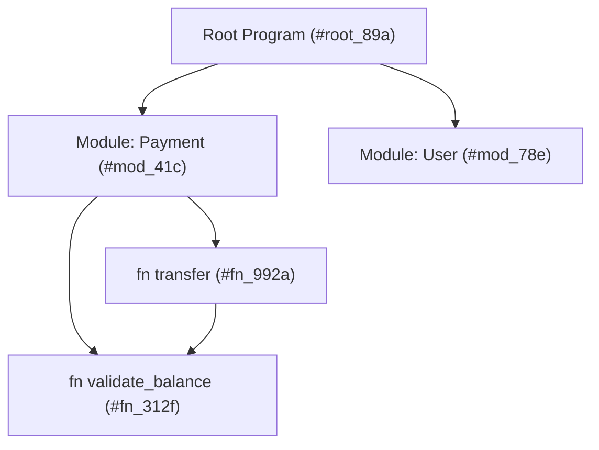
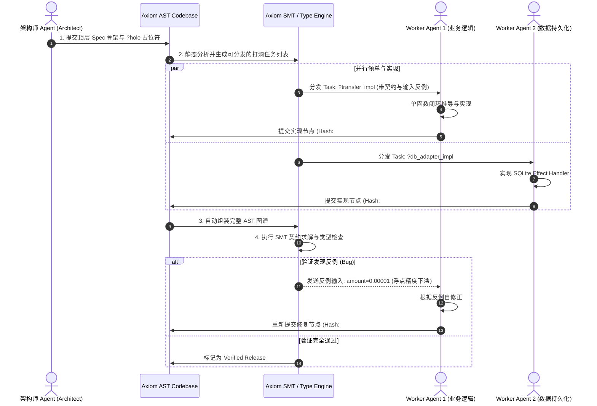

# Axiom 多 Agent 并发开发协议与内容寻址模型

---

## 1. 为什么传统 Git 不适合多 Agent 并行？

传统团队协作依赖于：
- 物理文件（Files）
- 文本行（Lines of text）
- 基于行差异的 Git Diff 与分支合并（Merge / Rebase）

当 10 个 AI Agent 同时在同一个模块添加方法或修复 Bug 时：
1. **命名碰撞**：Agent A 与 Agent B 给辅助函数起了相同名字但实现不同；
2. **行级冲突**：两个 Agent 修改了相邻代码行，导致 Git 无法自动合并并产生 Conflict Marker；
3. **依赖地狱**：Agent A 更改了函数签名，未能同步通知 Agent B，导致编译失败。

---

## 2. Axiom 的内容寻址 AST 解决方案

Axiom 借鉴了现代分布式版本控制与 Unison 语言的思想，将代码**以不可变的抽象语法树（AST）哈希**进行存储。



### 核心特性：
1. **无重名冲突**：函数在底层的唯一标识符是其 AST 的 Hash（如 `#fn_992a`）。用户看到的名称只是一个 Alias（标签）。如果两个 Agent 同时写了一个叫 `calculate_fee` 的函数，它们会被存储为不同的 Hash，互不覆盖。
2. **零 Git Merge 冲突**：代码提交是向 AST 图谱中追加新的不可变节点。合并时只需要合并图谱的根引用（Root Ref），不存在文本行的交错冲突。
3. **全局函数级编译缓存**：一旦某个函数被测试通过，其 Hash 永远有效，无论是本地 Agent 还是远程集群中的 Agent，均可 100% 命中二进制缓存。

---

## 3. 多 Agent 并发协作标准作业流程 (SOP)



---

## 4. 自动反例自愈协议 (Auto-Healing with Counter-Examples)

当 Worker Agent 填充的代码违反了 `requires` 或 `ensures` 契约时，Axiom 编译器不会仅仅抛出一串文字错误，而是返回 **SMT 求解出的精确反例**：

```json
{
  "status": "ContractViolation",
  "hole_id": "transfer_implementation",
  "violated_clause": "ensures: result.balance >= 0.0",
  "counter_example": {
    "from_user": { "balance": "100.00" },
    "amount": "100.01"
  },
  "diagnosis": "When amount > balance, execution path reaches deduction without throwing InsufficientBalance error.",
  "suggested_action": "Add an explicit branch checking `amount <= from_user.balance` before updating state."
}
```

Agent 收到此 JSON 后，可以在单次迭代内直接定位边界条件漏洞并精准修复。