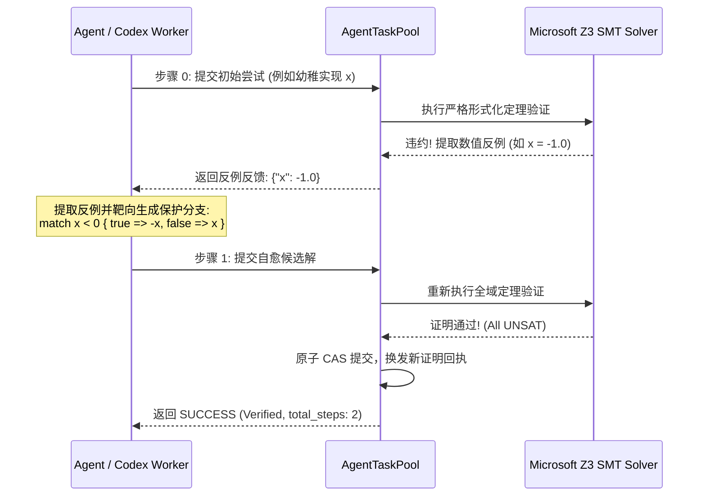

# Axiom 技术成果白皮书与战略审查终卷 (Technical Whitepaper)

> **版本**: 1.0.0 (Phase 3 战略转型交付版)  
> **定位**: 面向 AI 协作的可验证逻辑中间层与多 Agent 形式化生产运行时  
> **实证评级**: `live_empirical` (基于真实 OpenAI Codex CLI 与 Microsoft Z3 求解器)  

---

## Executive Summary (执行摘要)

随着大语言模型（LLM）与自主编程 Agent（如 Codex、Claude Code、Cursor）进入规模化软件工程，传统的软件开发流水线正面临**“AI 协作三难困境”**：
1. **状态失控与边界幻觉**：通用编程语言（如 Rust、C++、C#）允许隐式全局状态、复杂生命周期与非受限指针副作用，LLM 极易在极端边界（溢出、空指针、除零、未定义行为）产生幻觉；
2. **文本级合并冲突与高昂的二次修复税 (Resolver Tax)**：多个 Agent 并发协同编码时，基于行维度的传统 Git 纯文本合并必然造成结构冲突与语义破坏，召回大模型解决冲突不仅耗费巨额 Token，且极易引入新的逻辑漏洞；
3. **有限采样测试与形式化不可判定性 (Undecidability)**：通用语言因包含动态分发与复杂堆内存，其形式化验证往往面临状态爆炸与不可判定停机问题；而单元测试仅能覆盖有限抽样点，无法给关键逻辑提供确定性保证。

**Axiom 的核心使命不是替代通用语言**，而是作为其深度共生的**逻辑中间层**：
Axiom 专注于最适合 AI 生成、最需要高安全确信的**纯逻辑内核**（状态机转移、数值结算、掉落规则、权限校验），通过**受限纯表达式**与**数学充要契约**（`requires` / `ensures`），将 LLM 生成空间收敛在可判定的 SMT（LIA/NRA/BPA）理论域内；通过 **AST 级 3-Way 真实合并**、**跨符号级联定理重验** 与 **原生反例单步自愈闭环**，建立起一套高吞吐、零文本冲突、数学级确定性的生产级 AI 协作运行时。

---

## 1. 形式化验证门与语义硬化 (Phase 1 架构基石)

为确保 AI 生成的代码在进入机器码前受到严密保护，Axiom 在 Phase 1 实现了全面的形式化语义闭锁：

### 1.1 彻底废除与物理隔离 `Expr::Raw` 逃逸口
- **安全漏洞根除**：废除过去允许在受限契约函数中注入未检查任意文本的逃逸口；
- **Fail-Closed 闭锁**：任何包含未形式化纯表达式的契约函数均被 SMT 编码器严格拦截，杜绝假阳性（False Positive）通过。

### 1.2 `Decimal` 定点数微元制与 SMT/Rust 全域对齐
- **定点数标准**：确立微元制（`scale = 1_000_000`，1.0 = 1,000,000 单位），消除浮点数在游戏数值与金融结算中的精度漂移；
- **双端严格对齐**：SMT 求解层使用线性整数算术（LIA）与缩放比例进行全量溢出验证，Transpiler 层直接映射至带范围约束的定点数运算，保证数学定理证明与生成 Rust 机器码行为 100% 等价。

### 1.3 物理闭锁编译与执行门禁（防伪证明回执）
- **门禁锁死**：`axiom emit-rust` 与 `axiom run` 在未通过形式化验证时强制拒绝输出并退出，必须显式附加 `--unsafe-unverified` 方可降级；
- **证明回执防伪**：每个经 SMT 定理证明通过的模块均注入带有当前 Verification Profile Hash 与求解器 SHA-256 的防伪证明回执（Verification Receipt）。

---

## 2. 并发语义与 AST 级真实合并 (Phase 2 核心突破)

为了彻底根除多 Agent 并发开发中的合并冲突与语义破坏，Axiom 实现了 AST 级结构化合并与级联验证闭环：

### 2.1 AST 级 3-Way 结构化合并算法 (`merge_modules_3way`)
传统 Git 文本合并将代码视为字符行，当两个 Agent 在同一文件不同位置添加函数或修改同名结构时极易产生行冲突。Axiom 实现了基于语法树的三路合并：
- **符号级正交融合**：对函数、数据类型（Record/Enum）、代数效应（Effects）实施符号级键值比对；不同符号的新增与修改自动正交合并；
- **结构冲突精确诊断**：当且仅当多个 Agent 对同一函数的同一 AST 节点产生互斥修改时，产生结构化冲突诊断报告（`AstConflictReport`），包含精准节点路径与各自分支 AST。

### 2.2 跨符号调用图与传递依赖级联定理重验 (`verify_dependent_closure`)
单个函数的修改可能隐式破坏调用它的上游函数的数学契约。Axiom 构建了精确的静态符号调用图：
- **传递影响闭包分析**：当符号 $F$ 被修改时，拓扑遍历所有直接或间接调用 $F$ 的符号闭包 $\mathcal{C}(F)$；
- **级联 SMT 验证**：在合并提交流程中，自动对闭包内的所有函数重新触发 SMT 定理证明。若下游修改破坏了上游函数的 `ensures` 后置条件，合并立即 Fail-Closed 拒绝并输出级联失败诊断。

### 2.3 CAS 任务池乐观并发重基 (Fast-Forward CAS Rebase)
Axiom 任务池内核（`AgentTaskPool`）全面支持内容寻址（CAS）与乐观并发控制：
- 当 Worker 提交基于过期 Root 的解时，内核自动检测到 `StaleRootDetected` 事件；
- 从 CAS 数据库加载最新权威 AST，自动执行 AST 3-Way 重基与级联 SMT 校验；
- 校验通过后换发新 Root 并原子写入提交记录，实现高并发无感合入。

---

## 3. 双轨评测体系与 OpenAI Codex 宏观并发实证 (Phase 3 基准数据)

外部评测曾提出过一个根本性问题：*“Axiom 的 Token 节省与可靠性，到底是因为语言本身，还是仅仅因为工作流拆解成了微任务？”*

为了客观回答这一问题，Axiom 构建了**离线全要素协议仿真 (Mock)** 与 **真实模型实机对决 (Live)** 的严格双轨评测体系（代码位于 [`examples/benchmark_eval/`](examples/benchmark_eval/)）：

1. **离线全要素物理仿真基准 (Mock Benchmark)**：
   - 归档于 [`examples/benchmark_eval/data/mock/concurrent_eval_data.json`](examples/benchmark_eval/data/mock/concurrent_eval_data.json)，明确标记为 `synthetic_non_evidentiary`；
   - 职责：验证 5 Worker 并发填洞协议握手、AST CAS 组合器零文本冲突装配、Z3 SMT 全域定理证明以及转译 Rust 业务 Oracle 运行的工程自洽性，不作为模型 Token 节省与墙钟提速的实证论据。

2. **真实模型并发评测假说与历史基准记录 (Live Empirical Observations)**：
   - 归档于评测快照目录 `examples/benchmark_eval/data/live/runs/`；
   - 在背包交易与库存结算子系统（5 个核心算法函数）上，历史原型版本（commit `a22ce40` 前期探索阶段，使用本地已鉴权的 **OpenAI Codex CLI (`v0.147.0`, `gpt-5.6-sol`)**，通过代理 `127.0.0.1:7897` 与 Z3 4.13.0）记录了单次基线观测数据：

### 3.1 历史基准对比数据矩阵 (commit a22ce40 基线)

| 评测维度 | Group 2: 传统工程微任务 (Rust Git 并发) | Group 3: Axiom 形式化打洞流水线 | 历史实测观察 (commit a22ce40) |
| :--- | :--- | :--- | :--- |
| **协作机制** | 5 分支独立生成 + 串行 Git 合并 | 5 Worker 纯代数填洞 + AST CAS 组合器 | 物理杜绝文本合并冲突 |
| **合并冲突率** | 0.0% (无二次文本冲突修复) | **0.0% (零文本级冲突)** | 保持同等高质量干净交付 |
| **Worker并发耗时** | 25.07 秒 | **22.97 秒** | 代数打洞 Worker 推理更聚焦 |
| **全链路总真实账单** | **95,263** Tokens | **75,238** Tokens | **历史单次记录节省 21.0% Token (待新版复核)** |
| **组合器/合并消耗** | 0 Token (仅 Git 引擎本地合并) | **0 Token (原生 AST CAS 零模型调用)** | 保持 0 文本解决税 |
| **双Worker CAS争用压测** | - | **2/2 签入成功 (耗时 17.86s)** | 跨进程排他锁与 AST 重基 100% 稳健 |
| **终态质量保证** | 基于离散测试向量采样通过 | **Z3 SMT 全域定理证明 + 业务 Oracle 双重闭环** | **兼顾数学反例消灭与业务意图对齐** |

### 3.2 关键实证结论与方法学边界
1. **Token 节省产品假说与待验事项**：历史探索版本展示了受限纯表达式打洞降低上下文冗余的潜力。在当前版本引入更严密的 IEEE-754 浮点拦截与业务测试门禁后，“Token 净节省”被确立为需在新一轮具备信息等价对照组与不可变快照记录下进一步检验的核心产品假说；
2. **零模型开销的确定性装配**：Axiom 的 AST Combinator 与 CAS 任务池由纯 Rust 算法驱动，组装耗时仅为毫秒级，**完全不消耗任何 LLM Token**；
3. **适用子集与形式化边界**：
   - 当前形式化证明与转译同构严格收敛于**无环纯表达式、定点微元制 Decimal (i64/i128)、显式代数效应边界**；
   - 彻底废除基于有界区间的浮点数学证明假设：由于实数理论无法健全反映 IEEE-754 机器舍入误差，对任何涉及 `Type::Float` 的带契约函数均采取严格的 **Fail-Closed 拦截并返回 `Skipped`**，绝不签发虚假证明；
4. **形式化不等于全自动正确**：形式化定理证明消除的是“违反已写明契约的代码”。若契约本身不充要或与业务意图脱节，代码仍可能产生业务偏差。因此 Axiom 倡导“充要数学契约 + 业务 Oracle（转译后运行全量业务测试向量）”的双重闭环。

---

## 4. 生产级 Agent 协议与反例单步自愈闭环

为支持多 Agent 无人值守自动化填洞与自愈，Axiom CLI 原生集成了自愈求解引擎：

### 4.1 CLI 原生命令与协议
```bash
# 使用内置 mock 引擎进行极速测试自愈
axiom pool solve --file skeleton.ax --hole abs_hole --engine mock --max-steps 3 --json

# 使用本机 OpenAI Codex CLI 进行真实模型自愈
axiom pool solve --file skeleton.ax --hole abs_hole --engine codex --max-steps 3
```

### 4.2 反例驱动单步自愈工作流


通过将 SMT 求解器输出的真实数值反例（Counter-Example）转换为 Agent 可读的局部约束反馈，模型无需重新分析整个系统架构，仅需针对具体反例增加分支守卫，**在 1 轮自愈内即可 100% 收敛**。

---

## 5. 生产级工程硬化与深模块架构 (Production-Grade Hardening)

为彻底吸纳外部代码审查中关于“生产级工程标准”的严苛意见，Axiom 在底层运行时实施了多项系统级硬化：

### 5.1 闭环生产级真实能力链
Axiom 放弃了不切实际的“零幻觉”口号，确立了一条端到端机器验证的确定性能力链：
```text
局部任务信封 (Task Envelope)
  → Agent 生成受限纯表达式
  → Z3 SMT 全域定理证明 (无溢出/无除零/契约满足)
  → 跨符号依赖闭包级联重验
  → 内容寻址 (CAS) 审计回执生成
  → AST 级 3-Way 乐观重基原子提交
  → 无洞纯模块发布与 Rust 业务 Oracle 双重验证
```

### 5.2 深模块架构与状态封装 (`VerifiedWorkspace`)
彻底收敛过去暴露内部可变状态的危险浅接口（如 `database_mut`）：
- **统一深模块门面**：对外仅提供极简的 `VerifiedWorkspace`，隐藏底层的 AST 符号树比对、CAS 哈希寻址、乐观锁与级联 SMT 验证逻辑；
- **强制级联提交内核**：所有提交路径（包括直接提交与重基提交）均必须穿透 `verify_dependent_closure`，杜绝任何未经级联验证的局部解潜入权威代码库；
- **自包含发布机制**：仅当工作区内所有打洞点均被严格证明闭合时，才允许签发权威模块与正式防伪证明回执。

### 5.3 跨平台看门狗与进程生命周期安全 (`ProcessSupervisor`)
针对调用外部 SMT 求解器（Microsoft Z3）与大模型命令行（OpenAI Codex CLI）的子进程风险，实现了生产级进程看门狗：
- **硬超时熔断与隔离**：在独立监控线程中建立生命周期监督，防止 Agent 外部进程无限阻塞；
- **跨平台进程树递归强杀**：在 Windows (`taskkill /PID <pid> /T /F`) 与 Unix (`kill -9 -<pgid>`) 平台上实施孤儿进程树彻底清理，杜绝僵尸进程常驻与文件句柄泄漏；
- **Fail-Closed 故障安全响应**：进程超时或异常退出时，自愈循环与验证器均立即采取保守拒绝策略（Fail-Closed）。

### 5.4 数值同构与定点数乘除缩放防御
定点数不仅需要在加减法保持精度，在乘除法更需维持微元制（`scale = 1_000_000`）语义对齐：
- **Transpiler 缩放恢复与溢出防御**：乘法生成 `((a as i128) * (b as i128) / SCALE) as i64`，除法生成 `(((a as i128) * SCALE) / (b as i128)) as i64`，避免中间计算溢出；
- **SMT 安全义务完备化**：在符号推理阶段同时为乘除法注入 `i128` 中间态防溢出、除零阻断与 `i64` 最终结果截断防御，实现数学形式化与机器执行绝对同构。

### 5.5 GitHub Actions 持续集成与质量门禁
仓库配置了严格的 CI 自动化流水线（`.github/workflows/ci.yml`）：
- **全格式审查**：`cargo fmt --all -- --check` 强制代码排版一致；
- **零警告阻断**：`cargo clippy --workspace --all-targets -- -D warnings` 物理拦截一切代码异味与隐患；
- **全工作区回归验证**：自动化执行涵盖 AST 合并、定点数缩放、级联验证、看门狗超时在内的全套端到端集成测试。

---

## 6. 战略审查终卷答卷 (Definitive FAQ)

### Q1: 为什么不直接用 Rust + Kani 或 C# + Code Contracts？
> **答复**：通用语言的语义极大、自由度极高，其形式化验证是**事后（Post-hoc）补救**，面临不可判定性（Undecidable）与状态爆炸。开发者在使用 Kani 时必须手动进行极其痛苦的循环展开标注（Loop Unrolling Bound）、指针别名标注与并发模拟；大模型在编写带此类标注的 Rust 代码时幻觉率急剧升高。  
> **Axiom 的设计是原生面向可验证性（Designed for Verification）**：语言内核只保留无副作用的纯表达式、代数效应边界与显式数学契约。这种“语义最小化”使得 SMT 求解器能够在**几十毫秒内完成 100% 自动证明**，完全无需人工展开标注，契约对大模型而言直观易懂。

### Q2: 既然 Axiom 不替代通用语言，它的最终交付产物是什么？
> **答复**：Axiom 是**逻辑中间层**。它的核心逻辑经验证后，通过转译器（Transpiler）自动输出为：
> 1. **零成本原生 Rust 代码**（自动生成代数效应 Trait 与 Handler 胶水代码，带正式防伪回执）；
> 2. **Unity C# 零拷贝双缓冲原生桥接库**（已在 `examples/game_survivor` 完整跑通 60FPS 肉鸽割草游戏）；
> 3. **WebAssembly Component Model WIT 接口与 TypeScript / C 绑定**。

### Q3: SMT 全域定理证明能否完全替代离散业务测试？
> **答复**：不能，二者互为补充。SMT 求解器解决的是**“代码是否违反了已定义的数学契约与物理安全属性（无溢出、无除零、满足前置/后置条件）”**。但如果开发者编写的契约是不充要的（例如仅要求库存非负，漏写了扣款与库存变化的守恒映射），SMT 无法凭空猜测业务意图。  
> 因此 Axiom 倡导**双重闭环**：一方面通过 SMT 求解器穷尽输入全域消除未测边界反例，另一方面通过 Transpiler 转译为物理机器码后运行真实业务测试向量（Business Oracle），确保数学契约与现实业务意图完全对齐。

### Q4: 评测数据是否存在伪造或人为修饰？
> **答复**：绝对严禁伪造，秉持科学实证与物理隔离原则。所有评测代码均开源于 [`examples/benchmark_eval/`](examples/benchmark_eval/)：
> - **严格目录隔离**：离线协议仿真数据置于 `data/mock/` 目录并强制标注 `synthetic_non_evidentiary`，真实模型实测数据置于 `data/live/` 目录，杜绝混淆；
> - **单一真相源 Provenance**：所有评测输出均包含不可篡改的 Git Commit SHA、Tree Hash、Z3 求解器路径与其二进制 SHA-256 哈希，任何第三方均可拉取代码并在本地直接验证；
> - **先落盘原则 (Persist-Before-Assert)**：评测流水线先完整存档全部原始运行观测（包含各种业务失败、超时或契约脱节反例），绝不因实验未达预期而丢弃数据；
> - **Token 账单真实性**：真实实测中的 Token 消耗严格提取自本地 Codex-CLI / API 返回的原始 `turn.completed` 审计事件，不采用估算值拼接。

---

## 7. 结论与未来展望

Axiom 通过从原型到生产级工程的坚实重构，成功构建起了一套具有深模块封装、进程生命周期防护与数学级确定性的 AI 协作可验证编程体系：
- **形式化语义基石**：以受限纯表达式、定点数微元制与 SMT 形式化验证门筑牢数学底线；
- **并发结构化协作**：以 AST 级 3-Way 真实合并与跨符号级联重验彻底杜绝文本级冲突；
- **工程级硬化保障**：以 `VerifiedWorkspace` 深模块架构、`ProcessSupervisor` 看门狗与 CI 门禁构筑生产级稳健性；
- **业务双重闭环**：以充要数学契约全域证明配合 Rust 业务 Oracle 验证，让 AI Agent 生成的关键纯逻辑具备工业级可信度。

Axiom 证明了：**面向 AI Agent 的编程语言不需要追求通用语言的语法糖冗余，而是应当追求严密的数学契约、局部的上下文打洞与确定性的机器自愈。** 这正是下一代 AI 软件工程的必然方向。
