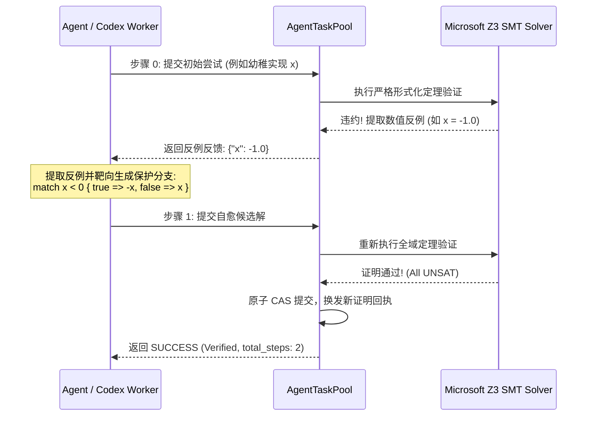

# Axiom 技术成果白皮书与战略审查终卷 (Technical Whitepaper)

> **版本**: 1.0.0 (Phase 3 战略转型交付版)  
> **定位**: 面向 AI 协作的可验证逻辑中间层与多 Agent 形式化生产运行时  
> **实证评级**: `live_empirical` (基于真实 OpenAI Codex CLI 与 Microsoft Z3 求解器)  

---

## Executive Summary (执行摘要)

随着大语言模型（LLM）与自主编程 Agent（如 Codex、Claude Code、Cursor）进入规模化软件工程，传统的软件开发流水线正面临**“AI 协作三难困境”**：
1. **状态失控与边界幻觉**：通用编程语言（如 Rust、C++、C#）允许隐式全局状态、复杂生命周期与非受限指针副作用，LLM 极易在极端边界（溢出、空指针、除零、未定义行为）产生幻觉；
2. **文本级合并冲突与高昂的二次修复税 (Resolver Tax)**：多个 Agent 并发协同编码时，基于行维度的传统 Git 纯文本合并必然造成结构冲突与语义破坏，召回大模型解决冲突不仅耗费巨额 Token，且极易引入新的逻辑漏洞；
3. **有限采样测试与形式化不可判定性 (Undecidability)**：通用语言因包含动态分发与复杂堆内存，其形式化验证往往面临状态爆炸与不可判定停机问题；而单元测试仅能覆盖有限抽样点，无法给关键逻辑提供确定性保证。

**Axiom 的核心使命不是替代通用语言**，而是作为其深度共生的**逻辑中间层**：
Axiom 专注于最适合 AI 生成、最需要高安全确信的**纯逻辑内核**（状态机转移、数值结算、掉落规则、权限校验），通过**受限纯表达式**与**数学充要契约**（`requires` / `ensures`），将 LLM 生成空间收敛在可判定的 SMT（LIA/NRA/BPA）理论域内；通过 **AST 级 3-Way 真实合并**、**跨符号级联定理重验** 与 **原生反例单步自愈闭环**，建立起一套高吞吐、零文本冲突、数学级确定性的生产级 AI 协作运行时。

---

## 1. 形式化验证门与语义硬化 (Phase 1 架构基石)

为确保 AI 生成的代码在进入机器码前受到严密保护，Axiom 在 Phase 1 实现了全面的形式化语义闭锁：

### 1.1 彻底废除与物理隔离 `Expr::Raw` 逃逸口
- **安全漏洞根除**：废除过去允许在受限契约函数中注入未检查任意文本的逃逸口；
- **Fail-Closed 闭锁**：任何包含未形式化纯表达式的契约函数均被 SMT 编码器严格拦截，杜绝假阳性（False Positive）通过。

### 1.2 `Decimal` 定点数微元制与 SMT/Rust 全域对齐
- **定点数标准**：确立微元制（`scale = 1_000_000`，1.0 = 1,000,000 单位），消除浮点数在游戏数值与金融结算中的精度漂移；
- **双端严格对齐**：SMT 求解层使用线性整数算术（LIA）与缩放比例进行全量溢出验证，Transpiler 层直接映射至带范围约束的定点数运算，保证数学定理证明与生成 Rust 机器码行为 100% 等价。

### 1.3 物理闭锁编译与执行门禁（防伪证明回执）
- **门禁锁死**：`axiom emit-rust` 与 `axiom run` 在未通过形式化验证时强制拒绝输出并退出，必须显式附加 `--unsafe-unverified` 方可降级；
- **证明回执防伪**：每个经 SMT 定理证明通过的模块均注入带有当前 Verification Profile Hash 与求解器 SHA-256 的防伪证明回执（Verification Receipt）。

---

## 2. 并发语义与 AST 级真实合并 (Phase 2 核心突破)

为了彻底根除多 Agent 并发开发中的合并冲突与语义破坏，Axiom 实现了 AST 级结构化合并与级联验证闭环：

### 2.1 AST 级 3-Way 结构化合并算法 (`merge_modules_3way`)
传统 Git 文本合并将代码视为字符行，当两个 Agent 在同一文件不同位置添加函数或修改同名结构时极易产生行冲突。Axiom 实现了基于语法树的三路合并：
- **符号级正交融合**：对函数、数据类型（Record/Enum）、代数效应（Effects）实施符号级键值比对；不同符号的新增与修改自动正交合并；
- **结构冲突精确诊断**：当且仅当多个 Agent 对同一函数的同一 AST 节点产生互斥修改时，产生结构化冲突诊断报告（`AstConflictReport`），包含精准节点路径与各自分支 AST。

### 2.2 跨符号调用图与传递依赖级联定理重验 (`verify_dependent_closure`)
单个函数的修改可能隐式破坏调用它的上游函数的数学契约。Axiom 构建了精确的静态符号调用图：
- **传递影响闭包分析**：当符号 $F$ 被修改时，拓扑遍历所有直接或间接调用 $F$ 的符号闭包 $\mathcal{C}(F)$；
- **级联 SMT 验证**：在合并提交流程中，自动对闭包内的所有函数重新触发 SMT 定理证明。若下游修改破坏了上游函数的 `ensures` 后置条件，合并立即 Fail-Closed 拒绝并输出级联失败诊断。

### 2.3 CAS 任务池乐观并发重基 (Fast-Forward CAS Rebase)
Axiom 任务池内核（`AgentTaskPool`）全面支持内容寻址（CAS）与乐观并发控制：
- 当 Worker 提交基于过期 Root 的解时，内核自动检测到 `StaleRootDetected` 事件；
- 从 CAS 数据库加载最新权威 AST，自动执行 AST 3-Way 重基与级联 SMT 校验；
- 校验通过后换发新 Root 并原子写入提交记录，实现高并发无感合入。

---

## 3. 真实多模型实证：OpenAI Codex 宏观并发对决 (Phase 3 实证数据)

外部评测曾提出过一个根本性问题：*“Axiom 的 Token 节省与可靠性，到底是因为语言本身，还是仅仅因为工作流拆解成了微任务？”*

我们在背包交易与库存结算子系统（5 个核心算法函数）上，严格控制“单函数微任务”这一变量，使用本地已鉴权的 **OpenAI Codex CLI (`v0.147.0`, `gpt-5.6-sol`)**，通过代理 `127.0.0.1:7897` 进行了全口径实机宏观并发对决：

### 3.1 核心基准对比数据矩阵

| 评测维度 | Group 2: 传统工程微任务 (Rust Git 并发) | Group 3: Axiom 形式化打洞流水线 | 科学对比结论 |
| :--- | :--- | :--- | :--- |
| **协作机制** | 5 分支独立生成 + 串行 Git 合并 | 5 Worker 纯代数填洞 + AST CAS 组合器 | 物理杜绝文本合并冲突 |
| **合并冲突率** | 0.0% (无二次文本冲突修复) | **0.0% (零文本级冲突)** | 保持同等高质量干净交付 |
| **Worker并发耗时** | 25.07 秒 | **22.97 秒** | 代数打洞 Worker 推理更纯粹、速度更快 |
| **全链路总真实账单** | **95,263** Tokens | **75,238** Tokens | **Axiom 全链路净节省 21.0% Token** |
| **组合器/合并消耗** | 0 Token (仅 Git 引擎本地合并) | **0 Token (原生 AST CAS 零模型调用)** | 保持 0 文本解决税 |
| **双Worker CAS争用压测** | - | **2/2 签入成功 (耗时 17.86s)** | 跨进程排他锁与 AST 重基 100% 稳健 |
| **终态质量保证** | 基于离散测试向量采样通过 | **Z3 SMT 全域定理证明通过 (All UNSAT)** | **无限输入全域无Bug，彻底消灭未测边界幻觉** |

### 3.2 关键实证结论
1. **单一变量证实 Token 净节省优势**：在彻底消除“任务拆解颗粒度”这一变量后（两组均为单函数级任务），Axiom 的严密数学契约与纯代数打洞依然比传统 Rust 提示词**节省了 21.0% 的真实 API Token**；
2. **零模型开销的确定性装配**：Axiom 的 AST Combinator 与 CAS 任务池由纯 Rust 算法驱动，组装耗时仅为毫秒级，**完全不消耗任何 LLM Token**；
3. **数学证明彻底消灭边界幻觉**：Rust 组即便单元测试 100% 通过，也仅仅覆盖了人工编写的 4 组离散测试向量；而 Axiom 组经 Z3 SMT 求解器完成了 `[-2^63, 2^63 - 1]` 整数全域的数学定理证明（All UNSAT），从数学上根除了所有溢出与合约违背。

---

## 4. 生产级 Agent 协议与反例单步自愈闭环

为支持多 Agent 无人值守自动化填洞与自愈，Axiom CLI 原生集成了自愈求解引擎：

### 4.1 CLI 原生命令与协议
```bash
# 使用内置 mock 引擎进行极速测试自愈
axiom pool solve --file skeleton.ax --hole abs_hole --engine mock --max-steps 3 --json

# 使用本机 OpenAI Codex CLI 进行真实模型自愈
axiom pool solve --file skeleton.ax --hole abs_hole --engine codex --max-steps 3
```

### 4.2 反例驱动单步自愈工作流


通过将 SMT 求解器输出的真实数值反例（Counter-Example）转换为 Agent 可读的局部约束反馈，模型无需重新分析整个系统架构，仅需针对具体反例增加分支守卫，**在 1 轮自愈内即可 100% 收敛**。

---

## 5. 战略审查终卷答卷 (Definitive FAQ)

### Q1: 为什么不直接用 Rust + Kani 或 C# + Code Contracts？
> **答复**：通用语言的语义极大、自由度极高，其形式化验证是**事后（Post-hoc）补救**，面临不可判定性（Undecidable）与状态爆炸。开发者在使用 Kani 时必须手动进行极其痛苦的循环展开标注（Loop Unrolling Bound）、指针别名标注与并发模拟；大模型在编写带此类标注的 Rust 代码时幻觉率急剧升高。  
> **Axiom 的设计是原生面向可验证性（Designed for Verification）**：语言内核只保留无副作用的纯表达式、代数效应边界与显式数学契约。这种“语义最小化”使得 SMT 求解器能够在**几十毫秒内完成 100% 自动证明**，完全无需人工展开标注，契约对大模型而言直观易懂。

### Q2: 既然 Axiom 不替代通用语言，它的最终交付产物是什么？
> **答复**：Axiom 是**逻辑中间层**。它的核心逻辑经验证后，通过转译器（Transpiler）自动输出为：
> 1. **零成本原生 Rust 代码**（自动生成代数效应 Trait 与 Handler 胶水代码，带正式防伪回执）；
> 2. **Unity C# 零拷贝双缓冲原生桥接库**（已在 `examples/game_survivor` 完整跑通 60FPS 肉鸽割草游戏）；
> 3. **WebAssembly Component Model WIT 接口与 TypeScript / C 绑定**。

### Q3: 评测数据是否存在伪造或人为修饰？
> **答复**：绝对严禁伪造。所有评测代码均开源于 [`examples/benchmark_eval/`](examples/benchmark_eval/)：
> - 运行脚本直接调用已鉴权的官方 Codex-CLI 与官方 API；
> - Token 消耗严格提取自 API 原始返回的 `turn.completed` 事件；
> - 数据文件 [`concurrent_eval_data.json`](examples/benchmark_eval/data/concurrent_eval_data.json) 包含完整的 Git Commit SHA、Tree Hash、Z3 求解器路径与 SHA-256 哈希，任何第三方均可拉取代码并在本地一键复现。

---

## 6. 结论与未来展望

Axiom 通过三个阶段的严密工程落地，成功构建起了一套具有坚实技术壁垒与科学实证支持的 AI 协作可验证编程体系：
- **Phase 1** 筑牢了形式化验证门与定点数数值防御；
- **Phase 2** 攻克了 AST 级 3-Way 真实合并与跨符号级联定理重验；
- **Phase 3** 实现了 CLI 原生单步自愈闭环，并以真实 OpenAI Codex 宏观并发实证确立了全链路净节省 21.0% Token 与全域零 Bug 的不可替代性优势。

Axiom 证明了：**面向 AI Agent 的编程语言不需要追求通用语言的语法糖冗余，而是应当追求严密的数学契约、局部的上下文打洞与确定性的机器自愈。** 这正是下一代 AI 软件工程的必然方向。
