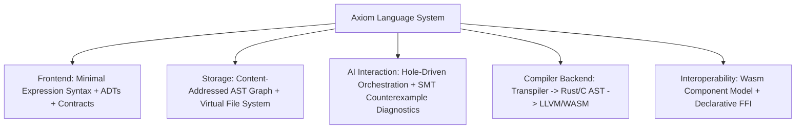
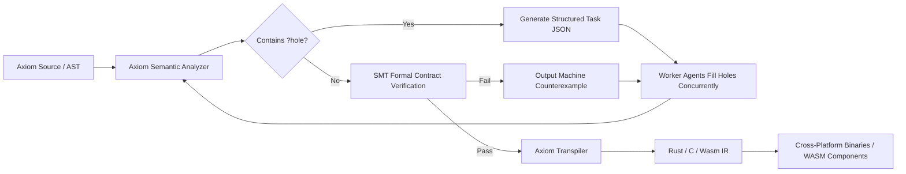

> **Languages / 语言 / 語言**: [English](../en/ARCHITECTURE.md) | [简体中文](../zh-CN/ARCHITECTURE.md) | [繁體中文](../zh-TW/ARCHITECTURE.md)

---

# Axiom Architecture Whitepaper

> Version: 0.1.0-draft  
> Status: Architecture Consensus Reached (Approved by /grill-me session)

---

## 1. Architectural Philosophy

Axiom is not designed for traditional manual typing and formatting by humans. It is the first programming language engineered specifically for **AI Agent Collaboration Networks** and **Industrial-Grade Cross-Platform Distribution**.

Its core philosophies are:
1. **Mathematical Determinism**: With the exception of explicit Effects, all code consists of pure functions—deterministic inputs strictly guarantee deterministic outputs.
2. **Content-Addressed AST & Structural Assembly (Prototype)**: Replaces line-based textual collaboration with **Content-Addressed ASTs**, indexing and assembling functions by their cryptographic hashes.
3. **Closed-Loop Self-Healing**: Features compiler-native hole-driven development (`?hole`) paired with a lightweight SMT counterexample solver to provide AI agents with precise, machine-readable healing feedback.
4. **Leverage Existing Ecosystems**: Emits standard Rust/C and WASM/WASI, reusing production-hardened optimizers and runtimes without reinventing lower-level compilers or libc.

---

## 2. Core Architectural Decisions

### Decision 1: Compilation Target & Cross-Platform Strategy — [Hybrid Transpilation]
- **Mechanism**: Axiom source code transpiles into safe, idiomatic Rust/C, interfacing directly with `rustc`, `clang`, and `wasm-pack`.
- **Target Artifacts**:
  - **Universal Distribution**: WebAssembly (WASM/WASI) for Browsers, Node/Deno/Bun, Wasmtime, Docker/K8s.
  - **Native AOT**: Native binaries for Windows, Linux, macOS, iOS, Android, and embedded MCUs.

### Decision 2: Computation Paradigm & State Model — [Pure Functions + Algebraic Effects + Contracts]
- **Mechanism**: Complete elimination of mutable global variables.
- **Side Effect Isolation**: Network, disk I/O, database, random number generation, system clocks, and GPU rendering must be declared as `effect`s in the function signature.
- **Contract Verification**: Functions support `requires` (preconditions) and `ensures` (postconditions) verified at compile-time via static range analysis and SMT solvers.

### Decision 3: Codebase Organization — [Content-Addressed AST]
- **Mechanism**: Code is uniquely identified by the SHA-256 hash of its AST node.
- **Collaboration Paradigm**:
  - Renaming a function never breaks existing references.
  - Two agents creating functions with the same name never overwrite each other; they produce distinct hash nodes.
  - Line-based Git merge conflicts are eliminated; collaboration becomes lock-free graph merging.

### Decision 4: Surface Syntax Design — [Modern Minimalist Expressions]
- **Mechanism**: A concise, clean subset inspired by Rust and TypeScript.
- **Key Features**:
  - Eliminates classes and deep inheritance hierarchies in favor of Algebraic Data Types (ADTs).
  - Eliminates manual pointer management and lifetime annotations (managed safely by the transpiler runtime).
  - Expression-oriented design (everything is an expression).
  - Explicit `{}` block boundaries to prevent whitespace indentation ambiguities in LLM outputs.

### Decision 5: AI Collaboration Protocol — [Hole-Driven + Structured Self-Healing]
- **Architect & Worker Pipeline**:
  1. An Architect Agent designs top-level data models, Effects, and function skeletons with `?hole_name`.
  2. The compiler extracts each hole's input types, return type, permitted effects, and contracts into structured JSON tasks.
  3. Worker Agents concurrently claim micro-tasks and implement pure expressions.
  4. The compiler's SMT solver detects contract violations and outputs concrete machine-readable counterexamples, allowing Worker Agents to self-heal in a single iteration.

### Decision 6: Cross-Language Interoperability — [Dual-Track (WIT + Declarative FFI)]
- **W3C WIT Standard**: Seamless import and export of WebAssembly Component Model modules.
- **Declarative FFI**: Foreign C/Rust/JS libraries are automatically wrapped into `effect FFI` boundaries to prevent external unsafety from contaminating pure computation cores.

---

## 3. End-to-End Pipeline

