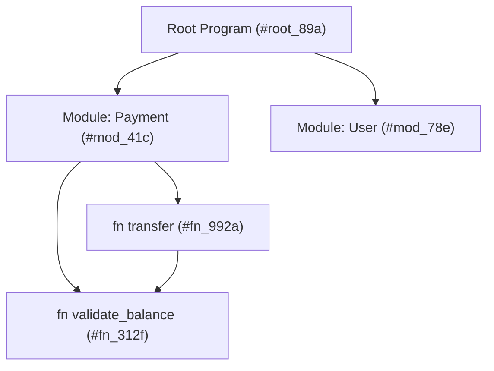
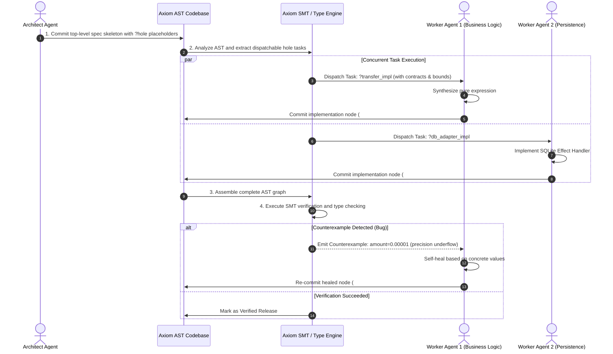

> **Languages / 语言 / 語言**: [English](../en/MULTI_AGENT_WORKFLOW.md) | [简体中文](../zh-CN/MULTI_AGENT_WORKFLOW.md) | [繁體中文](../zh-TW/MULTI_AGENT_WORKFLOW.md)

---

# Axiom Multi-Agent Collaboration Protocol & Content-Addressed Codebase

---

## 1. Why Traditional Git Fails Multi-Agent Concurrency

Traditional software development relies on:
- Physical source files
- Lines of text
- Line-based Git Diff, branch merging, and rebasing

When 10 AI agents simultaneously implement features or fix bugs in the same module:
1. **Naming Collisions**: Agent A and Agent B introduce helper functions with the same name but different logic.
2. **Line-Level Merge Conflicts**: Multiple agents edit adjacent lines, producing conflicting Git markers that break automated pipelines.
3. **Dependency Drift**: Agent A alters a function signature without immediate notification to Agent B, causing compilation failures across the workspace.

---

## 2. Axiom's Content-Addressed AST Solution

Inspired by modern distributed version control and the Unison programming language, Axiom stores code as **immutable Abstract Syntax Tree (AST) hashes**.



### Core Capabilities:
1. **Zero Naming Collisions**: Functions are identified internally by their AST hash (e.g., `#fn_992a`). User-facing names are aliases. If two agents define `calculate_fee` independently, both exist simultaneously under distinct hashes without collision.
2. **Zero Merge Conflicts**: Committing code appends new immutable nodes to the AST graph. Merging simply updates root references without textual line interleaving.
3. **Global Function-Level Build Cache**: Once a function is verified, its binary artifact is cached permanently by hash, yielding instant cache hits for local and clustered agents alike.

---

## 3. Standard Operating Procedure (SOP) for Multi-Agent Workflows



---

## 4. Automated Healing via SMT Counterexamples

When worker agent code violates a `requires` or `ensures` clause, the Axiom compiler does not merely report a textual error; it returns a **concrete SMT-derived counterexample**:

```json
{
  "status": "ContractViolation",
  "hole_id": "transfer_implementation",
  "violated_clause": "ensures: result.balance >= 0.0",
  "counter_example": {
    "from_user": { "balance": "100.00" },
    "amount": "100.01"
  },
  "diagnosis": "When amount > balance, execution path reaches deduction without throwing InsufficientBalance error.",
  "suggested_action": "Add an explicit branch checking `amount <= from_user.balance` before updating state."
}
```

Equipped with this structured diagnostic payload, agents repair boundary bugs in a single iteration without conversational trial and error.
