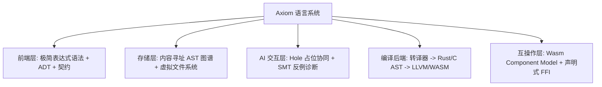
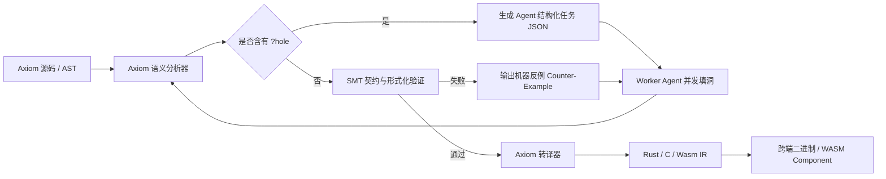

> **Languages / 语言 / 語言**: [English](../en/ARCHITECTURE.md) | [简体中文](../zh-CN/ARCHITECTURE.md) | [繁體中文](../zh-TW/ARCHITECTURE.md)

---

# Axiom 架构设计白皮书 (Architecture Whitepaper)

> 版本: 0.1.0-draft  
> 状态: 架构共识达成 (Approved by /grill-me session)

---

## 1. 架构设计哲学 (Architectural Philosophy)

Axiom 不是传统“为人类打字排版”设计的语言，而是第一门面向 **AI Agent 协作网络** 与 **工业级全平台分发** 的新型编程语言。

其核心哲学为：
1. **数学确定性 (Mathematical Determinism)**：除显式 Effect 外，所有代码都是纯函数，输入确定则输出必确定。
2. **结构化内容寻址 AST (Content-Addressed AST 原型)**：探索弃用传统基于行（Line-based）的文本合并，底层采用不可变 AST 的 SHA-256 哈希作为索引与投影，为多 Agent 并行开发提供无歧义的局部任务边界。
3. **闭环自愈 (Closed-loop Self-Healing)**：编译器内置打洞（Hole-driven）与轻量 SMT 反例求解器，给 Agent 机器可读的精确修复引导。
4. **站在巨人肩膀上 (Leverage Existing Ecosystem)**：不重复造底层优化器和 libc，编译前端输出标准 Rust/C 与 WASM/WASI。

---

## 2. 核心架构决策矩阵 (Core Decisions)

### 决策 1：编译底层与跨平台策略 —— 【A+C 混合】
- **机制**：Axiom 源码被转译为安全纯净的 Rust/C 代码，直接对接 `rustc` / `clang` 与 `wasm-pack`。
- **目标产物**：
  - **通用分发**：WebAssembly (WASM/WASI)，支持浏览器、Node/Deno/Bun、Wasmtime、Docker/K8s。
  - **原生 AOT**：直接编译为跨平台原生二进制（Windows / Linux / macOS / iOS / Android / 嵌入式 MCU）。

### 决策 2：计算范式与状态模型 —— 【纯函数 + 代数效应 + 契约】
- **机制**：彻底移除全局可变变量（No Mutable Global State）。
- **副作用隔离**：网络、文件、数据库、随机数、时间、图形渲染必须作为 `effect` 声明在函数签名上。
- **契约验证**：函数支持 `requires`（前置条件）与 `ensures`（后置条件），编译期进行静态范围分析与 SMT 求解。

### 决策 3：代码组织模型 —— 【内容寻址 AST (Content-Addressed)】
- **机制**：代码底层以 AST 节点的 SHA-256 哈希作为唯一标识。
- **协作革命**：
  - 函数改名不会破坏引用；
  - 多个 Agent 同时编写同名函数不会覆盖，而是产生两个不同 Hash 的独立函数节点；
  - 减少传统文本合并冲突，向“基于不可变 AST 哈希的引用装配”演进（注：当前原型通过原子任务池进行内存装配，分布式分支合并协议仍在探索设计中）。

### 决策 4：表层语法设计 —— 【现代极简表达式】
- **机制**：采用类似 Rust / TypeScript 的精简纯净子集。
- **语法特点**：
  - 消除 Class 与复杂继承树，仅使用 ADT (Sum Types / Product Types)；
  - 消除指针与生命周期标注（由转译器与纯函数运行时自动安全管理）；
  - 全表达式设计（Everything is an expression）；
  - 显式代码块 `{}`，杜绝空格缩进导致的语法解析二义性。

### 决策 5：AI 协同协议 —— 【Hole-Driven + 结构化反例闭环】
- **架构师与 Worker 协作链**：
  1. 架构师 Agent 定义顶层数据结构、Effect 与函数骨架，在待实现逻辑处标注 `?hole_name`；
  2. 编译器提取每个 `?hole` 的输入类型、输出类型、允许的 Effects 以及前置/后置条件，生成结构化 JSON 任务；
  3. Worker Agents 并发认领任务，针对单一函数进行确定性数学填空；
  4. 编译器结合轻量 SMT 求解器，若发现契约违背，直接生成导致出错的具体输入反例（Counter-Example），驱动 Worker Agent 自动单步自愈。

### 决策 6：跨语言互操作 —— 【双轨驱动 (WIT + 声明式 FFI)】
- **W3C WIT 标准**：无缝导入与导出 WebAssembly Component Model 模块；
- **声明式 FFI 包装**：调用已有 C/Rust/JS 生态库时，自动将其包裹为 `effect FFI`，防止外部不安全调用污染 Axiom 纯计算核心。

---

## 3. 系统数据流图 (End-to-End Pipeline)

