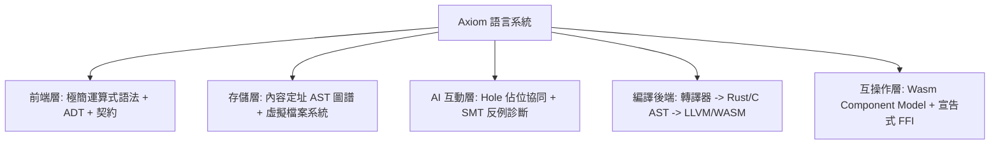
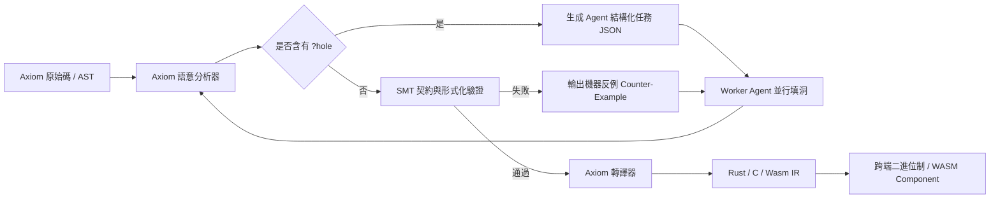

> **Languages / 语言 / 語言**: [English](../en/ARCHITECTURE.md) | [简体中文](../zh-CN/ARCHITECTURE.md) | [繁體中文](../zh-TW/ARCHITECTURE.md)

---

# Axiom 架構設計白皮書 (Architecture Whitepaper)

> 版本: 0.1.0-draft  
> 狀態: 架構共識達成 (Approved by /grill-me session)

---

## 1. 架構設計哲學 (Architectural Philosophy)

Axiom 不是傳統「為人類打字排版」設計的語言，而是第一門面向 **AI Agent 協作網路** 與 **工業級全平臺分發** 的新型程式語言。

其核心哲學為：
1. **數學確定性 (Mathematical Determinism)**：除顯式 Effect 外，所有代碼都是純函數，輸入確定則輸出必確定。
2. **零 Git 衝突 (Zero Git Conflicts)**：棄用基於行（Line-based）的文字協作，底層採用 **內容定址 AST (Content-Addressed AST)**，函數按 Hash 索引裝配。
3. **閉環自癒 (Closed-loop Self-Healing)**：編譯器內建打洞（Hole-driven）與輕量 SMT 反例求解器，提供 Agent 機器可讀的精確修復引導。
4. **站在巨人肩膀上 (Leverage Existing Ecosystem)**：不重複造底層最佳化器和 libc，編譯前端輸出標準 Rust/C 與 WASM/WASI。

---

## 2. 核心架構決策矩陣 (Core Decisions)

### 決策 1：編譯底層與跨平臺策略 —— 【A+C 混合】
- **機制**：Axiom 原始碼被轉譯為安全純淨的 Rust/C 代碼，直接對接 `rustc` / `clang` 與 `wasm-pack`。
- **目標產物**：
  - **通用分發**：WebAssembly (WASM/WASI)，支援瀏覽器、Node/Deno/Bun、Wasmtime、Docker/K8s。
  - **原生 AOT**：直接編譯為跨平臺原生二進位制（Windows / Linux / macOS / iOS / Android / 嵌入式 MCU）。

### 決策 2：計算範式與狀態模型 —— 【純函數 + 代數效應 + 契約】
- **機制**：徹底移除全域性可變變數（No Mutable Global State）。
- **副作用隔離**：網路、檔案、資料庫、隨機數、時間、圖形渲染必須作為 `effect` 宣告在函數簽名上。
- **契約驗證**：函數支援 `requires`（前置條件）與 `ensures`（後置條件），編譯期進行靜態範圍分析與 SMT 求解。

### 決策 3：代碼組織模型 —— 【內容定址 AST (Content-Addressed)】
- **機制**：代碼底層以 AST 節點的 SHA-256 雜湊作為唯一標識。
- **協作革命**：
  - 函數改名不會破壞引用；
  - 多個 Agent 同時編寫同名函數不會覆蓋，而是產生兩個不同 Hash 的獨立函數節點；
  - Git 合併衝突徹底歸零，協作變為「AST 圖譜的無鎖合併」。

### 決策 4：表層語法設計 —— 【現代極簡運算式】
- **機制**：採用類似 Rust / TypeScript 的精簡純淨子集。
- **語法特點**：
  - 消除 Class 與複雜繼承樹，僅使用 ADT (Sum Types / Product Types)；
  - 消除指標與生命週期標註（由轉譯器與純函數執行期自動安全管理）；
  - 全運算式設計（Everything is an expression）；
  - 顯式程式碼區塊 `{}`，杜絕空格縮排導致的語法解析歧義。

### 決策 5：AI 協同協定 —— 【Hole-Driven + 結構化反例閉環】
- **架構師與 Worker 協作鏈**：
  1. 架構師 Agent 定義頂層資料結構、Effect 與函數骨架，在待實現邏輯處標註 `?hole_name`；
  2. 編譯器提取每個 `?hole` 的輸入型別、輸出型別、允許的 Effects 以及前置/後置條件，生成結構化 JSON 任務；
  3. Worker Agents 並發認領任務，針對單一函數進行確定性數學填空；
  4. 編譯器結合輕量 SMT 求解器，若發現契約違背，直接生成導致出錯的具體輸入反例（Counter-Example），驅動 Worker Agent 自動單步自癒。

### 決策 6：跨語言互操作 —— 【雙軌驅動 (WIT + 宣告式 FFI)】
- **W3C WIT 標準**：無縫匯入與匯出 WebAssembly Component Model 模組；
- **宣告式 FFI 包裝**：呼叫已有 C/Rust/JS 生態庫時，自動將其包裹為 `effect FFI`，防止外部不安全呼叫污染 Axiom 純計算核心。

---

## 3. 系統資料流圖 (End-to-End Pipeline)

