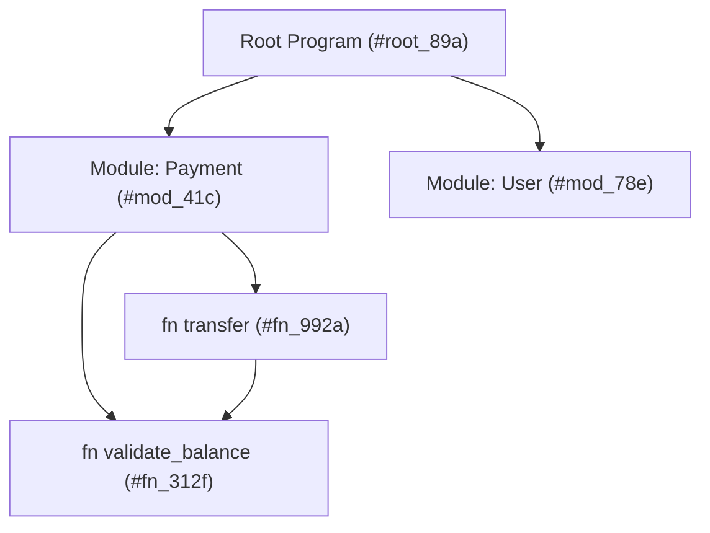
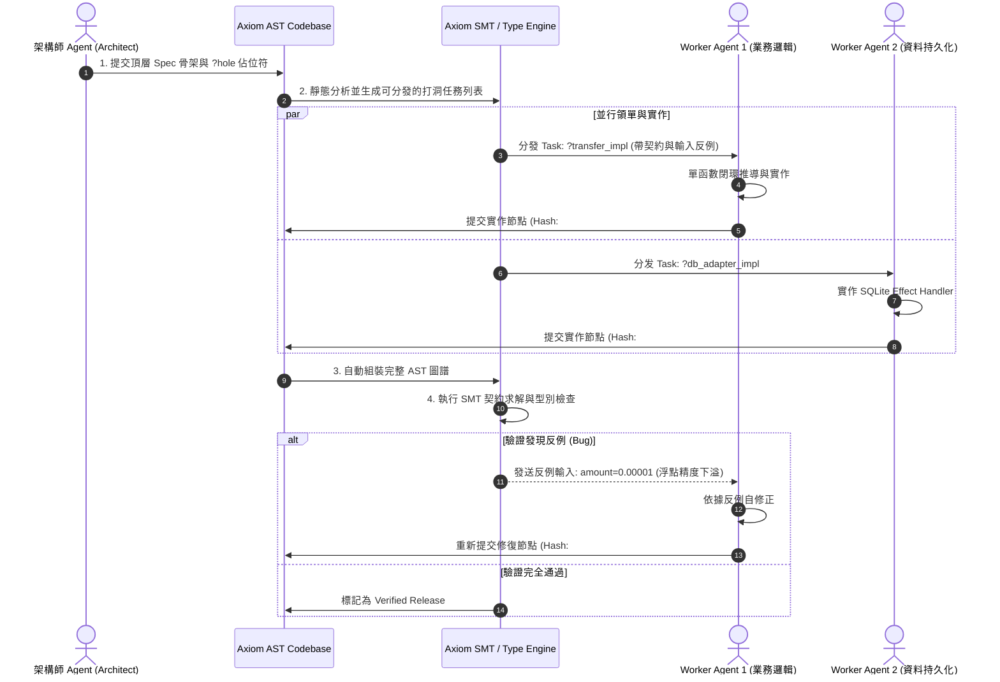

> **Languages / 语言 / 語言**: [English](../en/MULTI_AGENT_WORKFLOW.md) | [简体中文](../zh-CN/MULTI_AGENT_WORKFLOW.md) | [繁體中文](../zh-TW/MULTI_AGENT_WORKFLOW.md)

---

# Axiom 多 Agent 並行開發協定與內容定址模型

---

## 1. 為什麼傳統 Git 不適合多 Agent 並行？

傳統團隊協作依賴於：
- 實體檔案（Files）
- 文字行（Lines of text）
- 基於行差異的 Git Diff 與分支合併（Merge / Rebase）

當 10 個 AI Agent 同時在同一個模組添加方法或修復 Bug 時：
1. **命名碰撞**：Agent A 與 Agent B 為輔助函數命名相同但實作不同；
2. **行級衝突**：兩個 Agent 修改了相鄰代碼行，導致 Git 無法自動合併並產生 Conflict Marker；
3. **依賴地獄**：Agent A 更改了函數簽名，未能同步通知 Agent B，導致編譯失敗。

---

## 2. Axiom 的內容定址 AST 解決方案

Axiom 借鑒了現代分散式版本控制與 Unison 語言的思想，將代碼**以不可變的抽象語法樹（AST）雜湊**進行儲存。



### 核心特性：
1. **無重名衝突**：函數在底層的唯一識別碼是其 AST 的 Hash（如 `#fn_992a`）。使用者看到的名稱只是一個 Alias（標籤）。如果兩個 Agent 同時寫了一個叫 `calculate_fee` 的函數，它們會被儲存為不同的 Hash，互不覆蓋。
2. **結構化合併與減少衝突**：代碼提交是向 AST 圖譜中追加新的不可變節點。合併時只需要合併圖譜的根引用（Root Ref），不存在文字行的交錯衝突。
3. **確定性函數級快取**：以不可變 AST 的 SHA-256 Hash 作為鍵值，實現精確的語意級編譯與驗證快取。

---

## 3. 多 Agent 並發協作標準作業程序 (SOP)



---

## 4. 自動反例自癒協定 (Auto-Healing with Counter-Examples)

當 Worker Agent 填入的代碼違反了 `requires` 或 `ensures` 契約時，Axiom 編譯器不會僅拋出一串文字錯誤，而是回傳 **SMT 求解出的精確反例**：

```json
{
  "status": "ContractViolation",
  "hole_id": "transfer_implementation",
  "violated_clause": "ensures: result.balance >= 0.0",
  "counter_example": {
    "from_user": { "balance": "100.00" },
    "amount": "100.01"
  },
  "diagnosis": "When amount > balance, execution path reaches deduction without throwing InsufficientBalance error.",
  "suggested_action": "Add an explicit branch checking `amount <= from_user.balance` before updating state."
}
```

Agent 收到此 JSON 後，可在單次迭代內直接定位邊界條件漏洞並精準修復。
