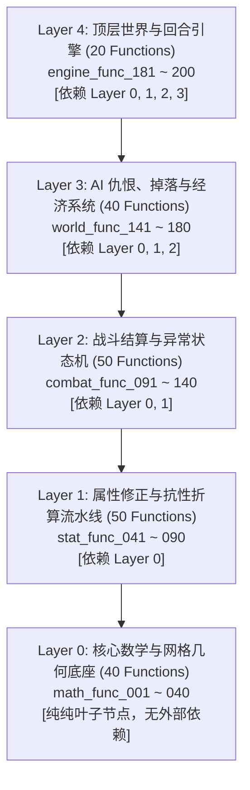

# 🏆 200-Functions 超大型跨层依赖基准评测规范 (Ultra-Scale 200-Functions Benchmark Spec)

## 1. 架构与 5 层拓扑依赖关系 (Topological 5-Tier Architecture)

本 Benchmark 构建了一个包含 **200 个紧密关联、层层向下依赖** 的大型游戏世界与战斗计算内核：

- **Layer 0 (Math Base, 40 funcs)**: 基础加法、插值、网格换算，契约要求非负数输入与非负数输出；
- **Layer 1 (Stats & Modifiers, 50 funcs)**: 属性强化与抗性修正，跨层调用 Layer 0 数学库；
- **Layer 2 (Combat Pipeline, 50 funcs)**: 破防结算与伤害计算，跨层调用 Layer 1 属性修正；
- **Layer 3 (AI & Economy, 40 funcs)**: 仇恨累加与威胁度计算，跨层调用 Layer 2 战斗管线；
- **Layer 4 (Engine Loop, 20 funcs)**: 回合步进与状态归一化，跨层调用 Layer 3 世界状态。

---

## 2. 评测工程目录结构

- [`examples/benchmark_200/ax/`](./ax/): Axiom 200 函数打洞骨架与 100% SMT 形式化证明源码
- [`examples/benchmark_200/py/`](./py/): Python 200 函数实现与 200 个单元测试用例
- [`examples/benchmark_200/rs/`](./rs/): Rust 200 函数 crate 与集成测试套件
- [`examples/benchmark_200/ts/`](./ts/): TypeScript 200 函数实现与测试套件
