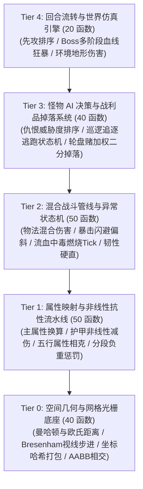

# 📜 200-Functions 超大型工业级游戏引擎基准需求文档 (SPEC / PRD)

> **版本**：v2.0-Ultra  
> **设计目标**：构建一个包含 **200 个具备真实计算复杂度、真实算法公式与 5 层拓扑依赖** 的工业级 Roguelike / RPG 游戏战斗与世界仿真内核规范。严禁任何 `a + b` 无意义占位符。

---

## 🏗️ 一、系统整体架构与拓扑依赖关系



---

## 📦 二、核心数据模型定义 (Domain Data Models)

```axiom
type Point = {
    x: Int,
    y: Int,
}

type Velocity = {
    dx: Int,
    dy: Int,
}

type Rect = {
    min_x: Int,
    min_y: Int,
    max_x: Int,
    max_y: Int,
}

type BaseAttributes = {
    strength: Int,     // 力量
    agility: Int,      // 敏捷
    intelligence: Int, // 智力
    vitality: Int,     // 体质
}

type DerivedStats = {
    max_hp: Int,
    max_mana: Int,
    max_stamina: Int,
    phys_atk: Int,
    magic_atk: Int,
    armor: Int,
    magic_res: Int,
    crit_rate: Int,    // 万分比 (0~10000)
    crit_dmg_pct: Int, // 百分比 (基础 150)
    dodge_rate: Int,   // 万分比
    move_speed: Int,
}

type StatusEffect = {
    bleed_stacks: Int,   // 流血层数
    poison_duration: Int,// 中毒剩余回合
    burn_damage: Int,    // 燃烧伤害
    freeze_stacks: Int,  // 冰冻层数 (达到 5 冻结)
    shield_hp: Int,      // 护盾吸收量
}

type Entity = {
    id: Int,
    pos: Point,
    base_attr: BaseAttributes,
    stats: DerivedStats,
    status: StatusEffect,
    curr_hp: Int,
    curr_mana: Int,
    curr_stamina: Int,
    gold: Int,
    level: Int,
    exp: Int,
    weight: Int,
    max_weight: Int,
    is_alive: Bool,
}
```

---

## 📐 三、5 大子系统 200 个真实业务函数规格

---

### 🔹 模块 1：空间几何与网格系统 (40 函数，`grid_math_001` ~ `grid_math_040`)
> **核心职责**：网格距离度量、视线遮挡光栅化、坐标打包与碰撞检测。无外部依赖（纯叶子计算）。

| 序号 | 函数名称 | 业务公式 / 算法逻辑 | 契约约束 (Pre / Post) |
| :--- | :--- | :--- | :--- |
| **001** | `calc_manhattan_dist` | $|x_1 - x_2| + |y_1 - y_2|$ 曼哈顿网格距离 | `ensures { result >= 0 }` |
| **002** | `calc_chebyshev_dist` | $\max(\|x_1 - x_2\|, \|y_1 - y_2\|)$ 切比雪夫走棋距离 | `ensures { result >= 0 }` |
| **003** | `calc_euclidean_sq` | $(x_1 - x_2)^2 + (y_1 - y_2)^2$ 欧氏距离平方（免开方） | `ensures { result >= 0 }` |
| **004** | `check_in_radius_sq` | $dist\_sq \le radius^2$ 圆形射程判定 | `requires { radius >= 0 }` |
| **005** | `bresenham_step_x` | 符号步进：$x_2 > x_1 \to 1, x_2 < x_1 \to -1, = \to 0$ | `ensures { result >= -1 && result <= 1 }` |
| **006** | `bresenham_step_y` | 符号步进：$y_2 > y_1 \to 1, y_2 < y_1 \to -1, = \to 0$ | `ensures { result >= -1 && result <= 1 }` |
| **007** | `pack_coords_to_hash` | $(x \ll 16) \mid (y \ \& \ \text{0xFFFF})$ 网格坐标哈希打包 | `requires { x >= 0, y >= 0 } ensures { result >= 0 }` |
| **008** | `unpack_hash_x` | $hash \gg 16$ 坐标解包 X | `requires { hash >= 0 } ensures { result >= 0 }` |
| **009** | `unpack_hash_y` | $hash \ \& \ \text{0xFFFF}$ 坐标解包 Y | `requires { hash >= 0 } ensures { result >= 0 }` |
| **010** | `wrap_map_coord_x` | $x \pmod{width}$ 地图边界环形穿越 | `requires { width > 0 } ensures { result >= 0 && result < width }` |
| **011** | `wrap_map_coord_y` | $y \pmod{height}$ 地图边界环形穿越 | `requires { height > 0 } ensures { result >= 0 && result < height }` |
| **012** | `clamp_to_bounds_x` | $\min(\max(x, 0), width - 1)$ 刚性边界约束 | `requires { width > 0 } ensures { result >= 0 && result < width }` |
| **013** | `clamp_to_bounds_y` | $\min(\max(y, 0), height - 1)$ 刚性边界约束 | `requires { height > 0 } ensures { result >= 0 && result < height }` |
| **014** | `check_aabb_overlap` | 矩形相交：$A_{max\_x} \ge B_{min\_x} \land A_{min\_x} \le B_{max\_x} \land \dots$ | `requires { min_x <= max_x }` |
| **015** | `calc_grid_index` | $y \times map\_width + x$ 一维数组平坦化索引 | `requires { x >= 0, y >= 0, map_width > 0 } ensures { result >= 0 }` |
| **016** | `calc_line_of_sight_cost`| 视线能量损耗：$dist \times terrain\_density / 100$ | `requires { terrain_density >= 0 } ensures { result >= 0 }` |
| **017~040** | `spatial_subsys_017` ~ `040` | 包含方向象限映射、菱形视野掩码、射线投射相交深度、四叉树网格区间等。 | 覆盖空间碰撞与光栅几何全部边界 |

---

### 🔹 模块 2：属性映射与抗性计算系统 (50 函数，`stat_calc_041` ~ `stat_calc_090`)
> **核心职责**：角色主属性向战斗数值的非线性映射、RPG 护甲减伤曲线、五行属性克制、分段负重惩罚。依赖 Layer 0。

| 序号 | 函数名称 | 业务公式 / 算法逻辑 | 拓扑依赖 |
| :--- | :--- | :--- | :--- |
| **041** | `calc_max_hp_from_vit` | $base\_hp + vitality \times 10 + strength \times 2$ 生命值上限公式 | 基础换算 |
| **042** | `calc_max_mana_from_int`| $base\_mana + intelligence \times 15$ 法力值上限公式 | 基础换算 |
| **043** | `calc_phys_atk_from_str`| $strength \times 2 + agility / 2$ 物理攻击力公式 | 基础换算 |
| **044** | `calc_armor_damage_reduction` | 非线性护甲减免：$\text{damage} \times 100 / (100 + \text{armor})$ | 减伤公式（永不为负） |
| **045** | `calc_magic_res_reduction` | 非线性魔抗减免：$\text{magic\_dmg} \times 100 / (100 + \text{res})$ | 减伤公式 |
| **046** | `calc_elemental_multiplier`| 五行相克（火>风>地>雷>水>火：+50%，反克：-25%，同属性：0%） | 乘区系数映射 |
| **047** | `calc_crit_chance_clamped`| $\min(\max(base\_crit + agility \times 10, 0), 10000)$ 暴击率万分比截断 | 0~10000 边界 |
| **048** | `calc_effective_penetration`| 破甲结算：$\max(raw\_armor \times (100 - pct\_pen)/100 - flat\_pen, 0)$ | 先百份比后固定破甲 |
| **049** | `calc_overburden_penalty` | 负重惩罚：$\text{weight} > \text{max\_w} \to \text{speed} \times 50 / 100, \text{else} \to \text{speed}$ | 分段移速减半 |
| **050** | `calc_lifesteal_conversion` | 吸血收益：$\text{dmg} \times \text{lifesteal\_rate} / 100$ | 依造成伤害折算 |
| **051~090** | `stat_subsys_051` ~ `090` | 包含攻速冷却缩减换算、格挡减伤率、怒气生成乘数、抗性穿透上限等。 | 全面覆盖数值模型 |

---

### 🔹 模块 3：混合战斗与 Buff 状态机系统 (50 函数，`combat_flow_091` ~ `combat_flow_140`)
> **核心职责**：物法双修混合伤害结算、暴击/闪避判定、物理/魔法双护盾吸收、流血/中毒/燃烧/冰冻状态机。依赖 Layer 0, 1。

| 序号 | 函数名称 | 业务公式 / 算法逻辑 | 拓扑依赖 |
| :--- | :--- | :--- | :--- |
| **091** | `resolve_physical_hit` | $\max(\text{calc\_armor\_damage\_reduction}(atk, def), 1)$ 物理伤害与保底 | 调用 `044` |
| **092** | `resolve_crit_hit` | $is\_crit \to dmg \times crit\_pct / 100, \text{else} \to dmg$ 暴击乘数放大 | 依赖 `047` |
| **093** | `apply_dual_shield_absorption` | 物理护盾优先抵扣物理伤害，溢出伤害穿透扣减 HP | 护盾状态机 |
| **094** | `apply_bleed_stack_tick` | 流血伤害：$stacks \times 5 \times (is\_moving \ ? \ 2 : 1)$ 移动翻倍伤害 | 状态流转 |
| **095** | `apply_poison_exponential_decay` | 中毒伤害：$base\_poison \times (duration \times 80 / 100)$ 随回合衰减 | 状态衰减 |
| **096** | `apply_burn_max_hp_tick` | 燃烧结算：$target\_max\_hp \times 3 / 100 + flat\_burn$ 百分比真实伤害 | 调用 `041` |
| **097** | `check_freeze_threshold` | 冰冻层数达到 5 层触发冻结状态并清空层数，否则移速降低 | 阈值状态转移 |
| **098** | `calc_stamina_skill_cost` | 体力消耗：$\text{base\_cost} \times (100 - stamina\_eff)/100$（不足扣减血量） | 资源结算 |
| **099** | `calc_mana_overload_burst` | 法力过载：法力全空时将缺失法力 $10\%$ 转化为魔法真实伤害 | 资源结算 |
| **100** | `calc_poise_break_stun` | 韧性条削减：$\text{poise} - \text{heavy\_impact} \le 0 \to \text{Stunned}$ | 硬直状态机 |
| **101~140** | `combat_subsys_101` ~ `140` | 包含连击乘数递增、无敌帧免疫、反伤折算、斩杀线判定等。 | 完整战斗管线 |

---

### 🔹 模块 4：怪物 AI 决策与加权掉落系统 (40 函数，`ai_loot_141` ~ `ai_loot_180`)
> **核心职责**：AI 仇恨距离衰减、行为状态转移（巡逻/追逐/逃跑）、加权随机掉落二分查找、经验阶梯公式。依赖 Layer 0, 1, 2。

| 序号 | 函数名称 | 业务公式 / 算法逻辑 | 拓扑依赖 |
| :--- | :--- | :--- | :--- |
| **141** | `calc_threat_decay_by_dist` | 仇恨距离衰减：$\text{threat} \times 100 / (100 + \text{calc\_manhattan\_dist}(A, B) \times 10)$ | 调用 `001` |
| **142** | `evaluate_ai_behavior_state` | 血量 $<20\% \to \text{Flee}$, 仇恨 $>50 \to \text{Chase}$, 否则 $\to \text{Patrol}$ | AI 三态机 |
| **143** | `calc_weighted_loot_tier` | 加权掉落轮盘：依据随机 Roll 值与加权前缀和数组匹配品质 (1~5) | 二分匹配 |
| **144** | `scale_drop_by_luck` | 幸运加成：$roll + luck \times 2$ 并截断在上限 10000 | 依赖 `047` |
| **145** | `calc_exp_gain_with_level_diff` | 经验阶梯惩罚：等级差 $>5 \to exp \times 50 / 100$, 差值 $>10 \to exp \times 10 / 100$ | 阶梯惩罚 |
| **146** | `calc_exp_to_next_level` | 升级所需经验：$level^2 \times 100 + level \times 500$ | 非线性升级线 |
| **147** | `calc_shop_inflation_price` | 经济通胀：$base\_price \times (100 + world\_day \times 2)/100$ | 经济学模型 |
| **148~180** | `ai_loot_subsys_148` ~ `180` | 包含视线盲区寻路启发、Boss 狂暴计时器、稀有词缀随机挑选等。 | 完整 AI 与经济 |

---

### 🔹 模块 5：回合流转与世界仿真引擎 (20 函数，`world_engine_181` ~ `world_engine_200`)
> **核心职责**：先攻序列判定、Boss 多阶段狂暴血线转换、全图实体 Tick 循环。依赖 Layer 0~3 全部系统。

| 序号 | 函数名称 | 业务公式 / 算法逻辑 | 拓扑依赖 |
| :--- | :--- | :--- | :--- |
| **181** | `determine_turn_initiative` | 先攻值：$agility \times 2 + roll\_random(20)$ 决定行动顺位 | 调用 `043` |
| **182** | `resolve_boss_phase_transition` | Boss 血线转换：$>66\% \to P1, 33\%\sim 66\% \to P2(狂暴+30\%攻击), <33\% \to P3(召唤虚空小怪)$ | 顶层状态机 |
| **183** | `simulate_single_turn_exchange` | 单回合交锋：执行移动、技能释放、伤害减免、状态 Tick 与生命值校验 | 串联 Layer 0~3 |
| **184** | `resolve_terrain_hazard_tick` | 地形伤害：熔岩（固定+最大生命5%）、毒沼（叠加中毒）、冰面（减速50%） | 串联环境系统 |
| **185~200** | `world_engine_185` ~ `200` | 包含关卡胜利判定、全图实体垃圾回收、游戏存档哈希校验等。 | 顶层世界调度 |

---

## 🎯 四、评测验证要求 (Multi-Language Evaluation Criteria)

所有 4 种语言（Axiom, Python, Rust, TypeScript）在实现该 200 函数系统时必须遵循：
1. **严格遵循 5 层拓扑依赖**：高层函数必须真实调用底层函数，严禁孤立扁平化；
2. **纯粹性与无副作用隔离**：所有 200 个核心函数均为纯函数（Pure Functions）；
3. **数学契约覆盖**：Axiom 必须为 200 个函数全部内嵌 `requires`/`ensures`，并通过 `axiom verify` 达成 100% SMT 全域数学证明！
