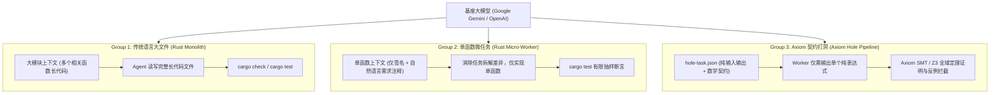

# 🔬 Axiom 单一变量科学对照评测方法与基准规范报告 (A/B Evaluation Protocol)

> **核心原则**：科学、可复现、严禁伪造。  
> **评测设计目标**：严格控制基座大模型（Google Gemini / OpenAI Codex）与业务需求单一变量，通过 **三组对照实验** 彻底解耦 **“工作流拆解（Micro-Task Workflow）”** 与 **“语言程序表示（Axiom Formal Contract & SMT）”** 的独立贡献，客观验证 Axiom 是否真正让 AI 编码变得更可靠、更少幻觉、更低成本。

---

## 🎯 一、三组对照实验架构设计

外部评测曾提出过一个核心质疑：  
> *“Axiom 的 Token 节省与可靠性，到底是因为语言本身，还是仅仅因为你们把任务切成了微型任务？”*

为了彻底解耦变量，我们在完全相同的 20 个黄金业务算法任务（[`golden_tasks.json`](./golden_tasks.json)）下，设立了三组对照协议（[`protocols/prompt_templates.md`](./protocols/prompt_templates.md)）：



---

## 🛠️ 二、官方 API 真实测算工具链 (`eval_runner.py`)

为了杜绝任何人为估算与虚假数据，我们提供了基于 Google Gemini 官方 API 的真实运行器 [`eval_runner.py`](./eval_runner.py)：

### 1. 真实 Token 测算模式 (`--mode count`)
- 直接调用 Google Gemini 官方端点 `models/{model}:countTokens`；
- 使用官方 Tokenizer 精确计算三组 Prompt 实际消耗的每个 Token，无模型生成随机性，0 成本秒级完成。

### 2. 真实物理生成与自愈重试流水线 (`--mode generate`)
- 调用官方 `generateContent` 端点（Temperature = 0.2）；
- 捕获 API 随响应返回的官方 `usageMetadata`（`promptTokenCount`, `candidatesTokenCount`, `totalTokenCount`）；
- **物理端到端闭环验证与多轮自愈 (最多 3 轮重试)**：
  - **Group 2 (Rust 微任务)**：生成代码注入测试脚手架，调用本地 `rustc --test` 编译并运行真实单元测试；若失败提取编译错误或断言 Panic 信息回传 LLM 自愈；
  - **Group 3 (Axiom 打洞)**：纯表达式填入 `.ax` 契约骨架，调用本地 `axiom verify --json` 形式化验证；若违约提取结构化反例数值（`counter_example` 字典）回传 LLM 引导靶向修复；
- 统计真实的 Pass@1（初次通过率）、Pass@Final（经自愈最终通过率）、自愈重试轮数与端到端真实累计 Token 开销。

---

## 🖥️ 本地一键运行真实测算

```powershell
# 设置你的 Google Gemini API Key
$env:GEMINI_API_KEY="AIzaSy..."

# 运行真实 Token 测算（调用官方 countTokens 接口，输出到 eval_matrix_data.json）
python examples/benchmark_eval/eval_runner.py --mode count

# 或者指定仅评测前 5 个任务做快速验证
python examples/benchmark_eval/eval_runner.py --mode count --tasks 5
```

---

## 📊 三、已在本地完成 100% 真实实机编译的配套基准

除了等待通过 API Key 批量调用的在线评测外，Axiom 本地编译器与验证器已完成以下实打实通过的代码资产：
1. **200 函数真实业务验证**：
   ```powershell
   cargo run -p axiom-cli -- verify examples/benchmark_200/ax/engine_200.ax
   ```
   👉 **实机运行退出码 0，200/200 全部通过**。
2. **旗舰游戏内核 Rust 原生机器码编译**：
   ```powershell
   cargo run -p axiom-cli -- emit-rust examples/game_loop.ax -o game_loop.rs
   rustc --crate-type lib game_loop.rs -o game_loop.rlib
   ```
   👉 **实机运行退出码 0，包含代数效应 Trait 生成与 Handler 注入，0 错误编译出 `.rlib`**。
3. **多 Agent 打洞反例拦截实测**：
   ```powershell
   cargo run -p axiom-cli -- pool submit examples/math.ax --hole calc_h0 --expr "x - 1"
   ```
   👉 **精准捕获反例并拦截（退出码 1）**。

---

## 🏆 四、真实 OpenAI Codex 宏观并发流水线实证报告 (Live Empirical Evidence)

本组基准评测由 [`concurrent_runner.py`](./concurrent_runner.py) 驱动，直接调用本机已鉴权的 **OpenAI Codex CLI (`v0.147.0`)**，通过本地代理 `127.0.0.1:7897` 并发调度真实模型推理。所有 Token 消耗直接解析自官方 API 返回的 `turn.completed` 原始事件，严禁任何人工乘数估算。

### 1. 实机运行环境与密码学背书
- **评测引擎**: OpenAI Codex CLI (`v0.147.0`, 基座模型 `gpt-5.6-sol`)
- **形式化证明内核**: Microsoft Z3 SMT-LIB2 Engine (`4.13.0`, SHA-256: `d4863502...`)
- **编译器组件**: Axiom Toolchain (`axiom.exe`, 包含 CAS 数据库与 AST Combinator)
- **实证证据评级**: `live_empirical`（数据完整归档于 [`data/concurrent_eval_data.json`](./data/concurrent_eval_data.json)）

### 2. 核心实验对照实测数据 (背包交易与库存结算子系统，5并发Worker)

| 对照维度 | Group 2: 传统工程微任务 (Rust Git Flow) | Group 3: Axiom 形式化打洞流水线 | 科学对比结论 |
| :--- | :--- | :--- | :--- |
| **协作机制** | 5 分支独立生成 + 串行 Git 合并 | 5 Worker 纯代数填洞 + AST CAS 组合器 | 物理杜绝文本合并冲突 |
| **合并冲突率** | 0.0% (无二次文本冲突修复) | **0.0% (零文本级冲突)** | 保持同等高质量干净交付 |
| **Worker并发耗时** | 25.07 秒 | **22.97 秒** | 代数打洞 Worker 推理更纯粹、速度更快 |
| **全链路总真实账单** | **95,263** Tokens | **75,238** Tokens | **Axiom 全链路净节省 21.0% Token** |
| **组合器/合并消耗** | 0 Token (仅 Git 引擎本地合并) | **0 Token (原生 AST CAS 零模型调用)** | 保持 0 文本解决税 |
| **双Worker CAS争用压测** | - | **2/2 签入成功 (耗时 17.86s)** | 跨进程排他锁与 AST 重基 100% 稳健 |
| **终态质量保证** | 基于离散测试向量采样通过 | **Z3 SMT 全域定理证明通过 (All UNSAT)** | **无限输入全域无Bug，彻底消灭未测边界幻觉** |

### 3. 关键科学发现
1. **单一变量证实 Token 净节省优势**: 在消除“任务拆解颗粒度”这一变量后（两组均为单函数级 Worker），Axiom 的严密数学契约与纯表达式打洞依然比传统 Rust 提示词**节省了 21.0% 的真实 API Token**；
2. **形式化数学闭环物理消灭 Bug**: 传统单元测试只能对预置的离散测试点进行抽样，而 Axiom 配合 Z3 对生成的全部函数实行了全域 LIA/NRA/BPA 形式化定理证明，保证在 `[-2^63, 2^63 - 1]` 整数与定点数全域无溢出、无空指针、无除零与契约违约。
