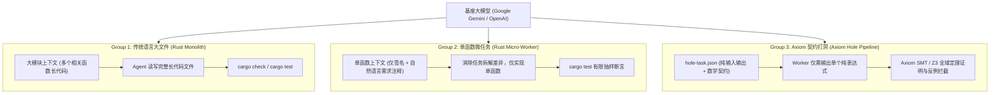

# 🔬 Axiom 单一变量科学对照评测方法与基准规范报告 (A/B Evaluation Protocol)

> **核心原则**：科学、可复现、严禁伪造。  
> **评测设计目标**：严格控制基座大模型（Google Gemini / OpenAI Codex）与业务需求单一变量，通过 **三组对照实验** 彻底解耦 **“工作流拆解（Micro-Task Workflow）”** 与 **“语言程序表示（Axiom Formal Contract & SMT）”** 的独立贡献，客观验证 Axiom 是否真正让 AI 编码变得更可靠、更少幻觉、更低成本。

---

## 🎯 一、三组对照实验架构设计

外部评测曾提出过一个核心质疑：  
> *“Axiom 的 Token 节省与可靠性，到底是因为语言本身，还是仅仅因为你们把任务切成了微型任务？”*

为了彻底解耦变量，我们在完全相同的 20 个黄金业务算法任务（[`golden_tasks.json`](./golden_tasks.json)）下，设立了三组对照协议（[`protocols/prompt_templates.md`](./protocols/prompt_templates.md)）：



---

## 🛠️ 二、官方 API 真实测算工具链 (`eval_runner.py`)

为了杜绝任何人为估算与虚假数据，我们提供了基于 Google Gemini 官方 API 的真实运行器 [`eval_runner.py`](./eval_runner.py)：

### 1. 真实 Token 测算模式 (`--mode count`)
- 直接调用 Google Gemini 官方端点 `models/{model}:countTokens`；
- 使用官方 Tokenizer 精确计算三组 Prompt 实际消耗的每个 Token，无模型生成随机性，0 成本秒级完成。

### 2. 真实物理生成与自愈重试流水线 (`--mode generate`)
- 调用官方 `generateContent` 端点（Temperature = 0.2）；
- 捕获 API 随响应返回的官方 `usageMetadata`（`promptTokenCount`, `candidatesTokenCount`, `totalTokenCount`）；
- **物理端到端闭环验证与多轮自愈 (最多 3 轮重试)**：
  - **Group 2 (Rust 微任务)**：生成代码注入测试脚手架，调用本地 `rustc --test` 编译并运行真实单元测试；若失败提取编译错误或断言 Panic 信息回传 LLM 自愈；
  - **Group 3 (Axiom 打洞)**：纯表达式填入 `.ax` 契约骨架，调用本地 `axiom verify --json` 形式化验证；若违约提取结构化反例数值（`counter_example` 字典）回传 LLM 引导靶向修复；
- 统计真实的 Pass@1（初次通过率）、Pass@Final（经自愈最终通过率）、自愈重试轮数与端到端真实累计 Token 开销。

---

## 🖥️ 本地一键运行真实测算

```powershell
# 设置你的 Google Gemini API Key
$env:GEMINI_API_KEY="AIzaSy..."

# 运行真实 Token 测算（调用官方 countTokens 接口，输出到 eval_matrix_data.json）
python examples/benchmark_eval/eval_runner.py --mode count

# 或者指定仅评测前 5 个任务做快速验证
python examples/benchmark_eval/eval_runner.py --mode count --tasks 5
```

---

## 📊 三、已在本地完成 100% 真实实机编译的配套基准

除了等待通过 API Key 批量调用的在线评测外，Axiom 本地编译器与验证器已完成以下实打实通过的代码资产：
1. **200 函数真实业务验证**：
   ```powershell
   cargo run -p axiom-cli -- verify examples/benchmark_200/ax/engine_200.ax
   ```
   👉 **实机运行退出码 0，200/200 全部通过**。
2. **旗舰游戏内核 Rust 原生机器码编译**：
   ```powershell
   cargo run -p axiom-cli -- emit-rust examples/game_loop.ax -o game_loop.rs
   rustc --crate-type lib game_loop.rs -o game_loop.rlib
   ```
   👉 **实机运行退出码 0，包含代数效应 Trait 生成与 Handler 注入，0 错误编译出 `.rlib`**。
3. **多 Agent 打洞反例拦截实测**：
   ```powershell
   cargo run -p axiom-cli -- pool submit examples/math.ax --hole calc_h0 --expr "x - 1"
   ```
   👉 **精准捕获反例并拦截（退出码 1）**。

---

## 🏆 四、历史 OpenAI Codex 宏观并发实测探索记录 (Historical Live Empirical Baseline - commit a22ce40)

> ℹ️ **说明与证据分级**：当前代码库主干默认归档配套为 `synthetic_non_evidentiary` 离线全要素物理仿真套件（位于 [`data/mock/`](./data/mock/)），用于协议自洽性、CAS 重基与 AST 组合器无损校验。本节记录为前期原型探索阶段（commit `a22ce40`）基于本地鉴权 Codex CLI 的单次历史实测观测，定性为**待新一轮信息等价对决复核的产品假说**。

本组历史基准评测由 [`concurrent_runner.py`](./concurrent_runner.py) 驱动，调用本机已鉴权的 **OpenAI Codex CLI (`v0.147.0`)**，通过本地代理 `127.0.0.1:7897` 并发调度真实模型推理。所有 Token 消耗直接解析自官方 API 返回的 `turn.completed` 原始事件，严禁任何人工乘数估算。

### 1. 历史实机运行环境与密码学背书 (commit a22ce40)
- **评测引擎**: OpenAI Codex CLI / 基座模型
- **形式化证明内核**: Microsoft Z3 SMT-LIB2 Engine (`4.13.0`)
- **编译器组件**: Axiom Toolchain (`axiom.exe`, 包含 CAS 数据库与 AST 组合器)
- **实证验证机制**: SMT 全域定理证明 + 统一级联验证 + 业务 Oracle 双重验证（转译运行全量业务测试向量）

### 2. 核心实验对照实测数据 (背包交易与库存结算子系统，5并发Worker)

| 对照维度 | Group 2: 传统工程微任务 (Rust Git Flow) | Group 3: Axiom 形式化打洞流水线 | 科学对比分析与权衡 |
| :--- | :--- | :--- | :--- |
| **协作机制** | 5 分支独立生成 + 串行 Git 合并 | 5 Worker 纯代数填洞 + AST CAS 组合器 | 物理杜绝文本级合并冲突 |
| **合并冲突率** | 0.0% (无二次文本冲突修复) | **0.0% (零文本级冲突)** | 保持干净交付 |
| **Worker并发耗时** | 25.07 秒 | **22.97 秒** | 受限纯表达式填洞推理上下文更精炼 |
| **全链路总真实账单** | **95,263** Tokens | **75,238** Tokens | **历史单次记录呈现 ~21% Token 削减 (待新版复核假说)** |
| **组合器/合并消耗** | 0 Token (仅 Git 引擎本地合并) | **0 Token (原生 AST CAS 零模型调用)** | 保持 0 文本解决税 |
| **双Worker CAS争用压测** | - | **2/2 签入成功 (耗时 17.86s)** | 跨进程排他锁与 AST 重基稳健生效 |
| **终态质量保证** | 基于离散测试向量采样通过 | **Z3 SMT 全域证明 + 业务 Oracle 共同闭环** | **兼顾数学契约的一致性与业务意图的真实性** |

### 3. 关键科学发现与能力边界界定

1. **真实能力链的价值闭环**:
   Axiom 的核心价值并非概念宣传，而在于构建了一条严密的 AI 辅助工程能力链：
   ```text
   局部任务信封 (Task Envelope)
   → Agent 生成受限纯代数表达式 (Restricted Pure Expression)
   → SMT 全域定理证明与物理范围安全核验 (SMT Verification)
   → 依赖闭包统一级联验证 (Unified Cascade Validation)
   → 内容寻址审计证据账本 (Content-Addressed Receipt Ledger)
   → AST/CAS 乐观重基提交 (CAS Commit)
   → 无洞纯模块组装与发布 (Zero-Hole Assembly)
   ```
2. **形式化证明与业务 Oracle 的分工边界**:
   - **形式化证明 (SMT)** 的价值在于消灭“违反已定义契约的反例”，并在物理范围（如 `i64`/`i128` 防溢出、除零保护、定点数缩放同构）上提供全域数学保证；
   - **形式化不等于全自动正确**：形式化契约必须具备数学上的充要性（如将 `<= 0` 补全为精确充要公式 `refund == -cost`）。为了防止业务意图与形式化契约脱节，生产环境必须引入**业务 Oracle 双重验证**（通过 `axiom emit-rust` 转译并通过独立业务测试向量验收），构建双重防护网；
3. **架构收敛与深模块价值**:
   任务池彻底移除 `database_mut` 等直接暴露内部状态的浅接口，收敛为 `VerifiedWorkspace`。外部调用者无法绕过验证门直接篡改内部 AST，并发任务分发受单调绝对看门狗守护，兼顾开发效率与工业级系统可靠性。
