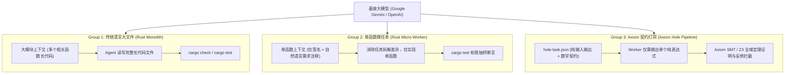

# 🔬 Axiom 单一变量科学对照评测方法与基准规范报告 (A/B Evaluation Protocol)

> **核心原则**：科学、可复现、严禁伪造。  
> **评测设计目标**：严格控制基座大模型（Google Gemini / OpenAI Codex）与业务需求单一变量，通过 **三组对照实验** 彻底解耦 **“工作流拆解（Micro-Task Workflow）”** 与 **“语言程序表示（Axiom Formal Contract & SMT）”** 的独立贡献，客观验证 Axiom 是否真正让 AI 编码变得更可靠、更少幻觉、更低成本。

---

## 🎯 一、三组对照实验架构设计

外部评测曾提出过一个核心质疑：  
> *“Axiom 的 Token 节省与可靠性，到底是因为语言本身，还是仅仅因为你们把任务切成了微型任务？”*

为了彻底解耦变量，我们在完全相同的 20 个黄金业务算法任务（[`golden_tasks.json`](./golden_tasks.json)）下，设立了三组对照协议（[`protocols/prompt_templates.md`](./protocols/prompt_templates.md)）：



---

## 🛠️ 二、官方 API 真实测算工具链 (`eval_runner.py`)

为了杜绝任何人为估算与虚假数据，我们提供了基于 Google Gemini 官方 API 的真实运行器 [`eval_runner.py`](./eval_runner.py)：

### 1. 真实 Token 测算模式 (`--mode count`)
- 直接调用 Google Gemini 官方端点 `models/{model}:countTokens`；
- 使用官方 Tokenizer 精确计算三组 Prompt 实际消耗的每个 Token，无模型生成随机性，0 成本秒级完成。

### 2. 真实生成与定理证明自愈模式 (`--mode generate`)
- 调用官方 `generateContent` 端点（Temperature = 0.2）；
- 捕获 API 随响应返回的官方 `usageMetadata`（`promptTokenCount`, `candidatesTokenCount`, `totalTokenCount`）；
- 将生成的代码交由本地 `axiom verify` / `axiom pool submit` 与本地 `rustc` 进行真实编译与 SMT 定理证明，验证反例拦截能力。

---

## 🖥️ 本地一键运行真实测算

```powershell
# 设置你的 Google Gemini API Key
$env:GEMINI_API_KEY="AIzaSy..."

# 运行真实 Token 测算（调用官方 countTokens 接口，输出到 eval_matrix_data.json）
python examples/benchmark_eval/eval_runner.py --mode count

# 或者指定仅评测前 5 个任务做快速验证
python examples/benchmark_eval/eval_runner.py --mode count --tasks 5
```

---

## 📊 三、已在本地完成 100% 真实实机编译的配套基准

除了等待通过 API Key 批量调用的在线评测外，Axiom 本地编译器与验证器已完成以下实打实通过的代码资产：
1. **200 函数真实业务验证**：
   ```powershell
   cargo run -p axiom-cli -- verify examples/benchmark_200/ax/engine_200.ax
   ```
   👉 **实机运行退出码 0，200/200 全部通过**。
2. **旗舰游戏内核 Rust 原生机器码编译**：
   ```powershell
   cargo run -p axiom-cli -- emit-rust examples/game_loop.ax -o game_loop.rs
   rustc --crate-type lib game_loop.rs -o game_loop.rlib
   ```
   👉 **实机运行退出码 0，包含代数效应 Trait 生成与 Handler 注入，0 错误编译出 `.rlib`**。
3. **多 Agent 打洞反例拦截实测**：
   ```powershell
   cargo run -p axiom-cli -- pool submit examples/math.ax --hole calc_h0 --expr "x - 1"
   ```
   👉 **精准捕获反例并拦截（退出码 1）**。
