# 📋 A/B 对照评测提示词协议规范 (Evaluation Protocols)

> **核心原则**：严格控制单一变量，在**完全相同基座大模型（LLM）、相同采样参数（Temperature = 0.2）与完全相同业务算法需求**下，测试不同程序表示对 AI 编码可靠性、Token 消耗与反例防御的根本影响。

---

## 🎯 一、三组对照架构设计

```mermaid
graph TD
    LLM["基座大模型 (Same Model & Temp)"]
    
    subgraph Group1["Group 1: 传统语言大文件工作流 (Rust Monolith)"]
        P1["大模块上下文 (40~50 函数长文件)"] --> R1["LLM 查找并实现目标函数"]
        R1 --> C1["cargo check / cargo test"]
        C1 --> E1["模糊编译/单测失败报错重试"]
    end
    
    subgraph Group2["Group 2: 传统语言微任务工作流 (Rust Micro-Worker)"]
        P2["单函数上下文 (仅签名 + 自然语言注释需求)"] --> R2["LLM 填充该函数体"]
        R2 --> C2["cargo check / cargo test"]
        C2 --> E2["模糊编译/单测失败报错重试"]
    end
    
    subgraph Group3["Group 3: Axiom 形式化契约打洞 (Axiom Hole Pipeline)"]
        P3["hole-task.json 极简微上下文 (输入输出 + 数学契约)"] --> R3["LLM 生成纯无副作用表达式"]
        R3 --> C3["Axiom SMT / Z3 定理证明"]
        C3 --> E3["精准边界反例反馈单步自愈"]
    end

    LLM --> Group1
    LLM --> Group2
    LLM --> Group3
```



---

## 📝 二、三组具体提示词协议模板 (Prompt Templates)

### 1. Group 1 协议（传统 Rust 大文件全上下文）
- **输入环境**：包含领域结构体定义与其余 19 个相关函数的完整 `engine.rs` 文件（约 500~800 行代码）；
- **系统提示词 (System Prompt)**：
  ```markdown
  You are an expert Rust systems engineer. Below is the full combat and world simulation engine file.
  Implement the target function marked with `todo!()`. Maintain all existing types and conventions.
  Do not introduce new compiler warnings or panics.
  ```
- **反馈重试循环**：
  若编译或单元测试失败，将 `cargo test` 抛出的完整堆栈或错误日志反馈给 LLM。

---

### 2. Group 2 协议（传统 Rust 单函数微任务，消除任务粒度差异）
- **输入环境**：仅提取目标函数的单签名与自然语言需求描述（不暴露无关函数）：
- **系统提示词 (System Prompt)**：
  ```markdown
  You are an expert Rust engineer. Implement the following single Rust function:
  
  ```rust
  /// Description: Calculate non-linear armor damage reduction: 
  /// raw_damage - (raw_damage * armor) / (armor + 100). Minimum damage is 1.
  /// Preconditions: raw_damage >= 1, armor >= 0
  /// Postconditions: result >= 1 and result <= raw_damage
  pub fn calc_armor_damage_reduction(raw_damage: i64, armor: i64) -> i64 {
      // TODO: implement
  }
  ```
  Return ONLY the complete function implementation code.
  ```
- **反馈重试循环**：
  若编译失败或预设单元测试断言失败，将测试失败信息反馈给 LLM。

---

### 3. Group 3 协议（Axiom 形式化契约打洞工作流）
- **输入环境**：由 `axiom extract-holes` 机械导出的标准任务 JSON（无任何自然语言模糊修饰，纯数学规范）：
- **任务定义 (`hole-task.json`)**：
  ```json
  {
    "task_id": "hole_calc_armor_damage_reduction",
    "function_name": "calc_armor_damage_reduction",
    "inputs": [
      { "name": "raw_damage", "type": "Int" },
      { "name": "armor", "type": "Int" }
    ],
    "output_type": "Int",
    "effects": [],
    "contracts": {
      "requires": ["raw_damage >= 1", "armor >= 0"],
      "ensures": ["result >= 1", "result <= raw_damage"]
    }
  }
  ```
- **系统提示词 (System Prompt)**：
  ```markdown
  You are an Axiom micro-worker. Write ONLY a single pure expression to fill the hole for the task described in JSON.
  Do NOT write full function signatures. The expression must be side-effect free and strictly satisfy the contracts.
  ```
- **反馈自愈循环**：
  若 SMT 求解器捕获反例，Axiom 自动生成 `DiagnosticReport`，给出具体数学反例赋值（例如 `{"raw_damage": 1, "armor": 0}`），LLM 基于具体违规输入单步修复。
