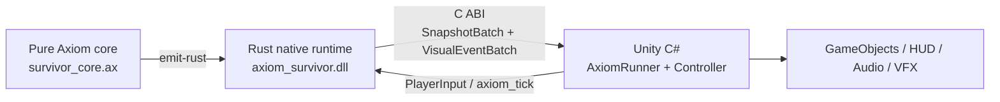

> **Languages / 语言 / 語言**: [English](README.en.md) | [简体中文](README.zh-CN.md) | [繁體中文](README.zh-TW.md)

---

# 🎮 Axiom Survivors: Complete Unity Showcase

`game_survivor` is a runnable Windows x86_64 Unity 2022 LTS example. Its gameplay rules are written in Axiom, transpiled into a Rust native runtime, and exposed to the Unity C# presentation layer through a stable C ABI DLL that publishes entity snapshots and visual events.

## Why this showcase matters

- **100% pure-functional gameplay core**: every state transition in `ax/survivor_core.ax` depends only on explicit inputs. Clocks, random sources, renderers, and Unity objects do not leak into the rules layer.
- **SMT-backed formal contracts**: collision, HP clamping, damage reduction, movement, and level progression declare `requires` / `ensures` contracts. `axiom verify` checks them statically and reports counterexamples on failure.
- **Low GC pressure on the core hot path**: the Rust runtime preallocates fixed-capacity buffers for 64 entities and 16 visual events, while C# reuses double-buffered snapshot arrays instead of creating a new collection every tick. Unity prefab spawning, particles, and destruction remain normal presentation-layer allocations.
- **A real cross-language boundary**: this is not a C# port disguised as interop. `axiom bridge --target unity` generates P/Invoke declarations, data layouts, double buffering, an asset registry, and a `MonoBehaviour` runner that calls `axiom_survivor.dll`.

## Architecture



| Layer | Responsibility | Key files |
| :--- | :--- | :--- |
| Axiom rules | Immutable data, deterministic algorithms, pre/postconditions | [`ax/survivor_core.ax`](ax/survivor_core.ax) |
| Rust native runtime | Fixed-capacity runtime state, scheduling, stable C ABI, DLL lifetime | [`native/src/lib.rs`](native/src/lib.rs) |
| Generated bridge | P/Invoke signatures, `Sequential` layouts, C# double buffering, asset mappings | [`Assets/Scripts/AxiomBridge/`](Assets/Scripts/AxiomBridge/) |
| Unity presentation | Input, entity-view lifecycle, HUD, animation, audio, and particles | [`SurvivorGameController.cs`](Assets/Scripts/Gameplay/SurvivorGameController.cs) |

## Prerequisites

- Windows x86_64 (the build script currently copies a Windows `.dll`)
- A stable Rust toolchain with Cargo
- PowerShell 5.1+
- .NET 6 SDK for standalone C# validation without launching Unity
- Unity `2022.3.62f3`, or a compatible Unity 2022.3 LTS editor, only when opening and playing the project

## Build the bridge and DLL

From the repository root, run:

```powershell
powershell -ExecutionPolicy Bypass -File examples/game_survivor/build_bridge.ps1
```

The script performs these steps:

1. Runs `axiom bridge --target unity` to regenerate `Assets/Scripts/AxiomBridge/*.cs`.
2. Runs `axiom emit-rust` to regenerate `native/src/generated_core.rs`.
3. Formats and tests `axiom-survivor-native`.
4. Builds the release `cdylib` and copies `target/release/axiom_survivor.dll` to `Assets/Plugins/x86_64/`.

To inspect the key generation stages individually, run:

```powershell
# Check the Axiom contracts
cargo run -p axiom-cli -- verify examples/game_survivor/ax/survivor_core.ax

# Generate the Unity C# bridge
cargo run -p axiom-cli -- bridge examples/game_survivor/ax/survivor_core.ax `
  --target unity `
  --out examples/game_survivor/Assets/Scripts/AxiomBridge `
  --library-name axiom_survivor

# Generate the Rust code consumed by the native runtime
cargo run -p axiom-cli -- emit-rust examples/game_survivor/ax/survivor_core.ax `
  --output examples/game_survivor/native/src/generated_core.rs
```

> `Assets/Scripts/AxiomBridge/*.cs` and `native/src/generated_core.rs` are generated artifacts. Change the Axiom source or generator rather than editing these files by hand.

## Run E2E validation without Unity

```powershell
# Rust workspace and native runtime
cargo test --workspace

# Regenerate the bridge, test the native runtime, build the DLL, and install it
powershell -ExecutionPolicy Bypass -File examples/game_survivor/build_bridge.ps1

# Exercise real P/Invoke and the C# presentation layer through Unity API stubs
dotnet run --project examples/game_survivor/Tests/Standalone/SurvivorRuntimeTests.csproj
```

The standalone suite validates DLL initialization, snapshot revision after 100 ticks, entity-view creation/update/removal, and visual-event routing.

## Run in Unity

1. Open `examples/game_survivor/` in Unity Hub, then open `Assets/Scenes/SampleScene.unity`.
2. Add `AxiomRunner` and `SurvivorGameController` to the same GameObject. The controller automatically finds its sibling runner.
3. Create an `AxiomAssetRegistry` through **Assets > Create > Axiom > Asset Registry**, configure optional prefabs and audio for `EntityKind` / `VisualEventKind`, and assign it to the runner.
4. On the controller, assign an entity root and any optional Sprite, Animator, AudioSource, ParticleSystem, and health/level/score HUD references.
5. Enter Play Mode. The runner polls the legacy `Horizontal`, `Vertical`, and `Fire1` inputs by default. Alternatively, disable `pollLegacyInput` and call `SetInput` from another input system.

## Validation boundaries

- `axiom verify` proves the numeric contracts declared in the Axiom core. It does not claim a formal proof of Unity rendering, native scheduling, or asset configuration.
- The Rust test checks that the fixed buffers do not reallocate across 100 ticks. The standalone .NET suite checks the C ABI, double buffering, and Unity presentation logic.
- Scenes, prefabs, animations, and performance targets still require acceptance testing in the Unity Editor/Player.
