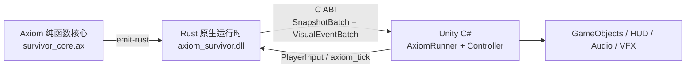

> **Languages / 语言 / 語言**: [English](README.en.md) | [简体中文](README.zh-CN.md) | [繁體中文](README.zh-TW.md)

---

# 🎮 Axiom Survivors：完整 Unity Showcase

`game_survivor` 是一个可运行的 Windows x86_64 Unity 2022 LTS 示例：玩法规则用 Axiom 编写，转译后嵌入 Rust 原生运行时，再通过稳定的 C ABI DLL 把快照与视觉事件传给 Unity C# 表现层。

## 为什么这个示例值得关注

- **100% 纯函数玩法核心**：`ax/survivor_core.ax` 的状态转移只依赖显式输入；时钟、随机数、渲染器和 Unity 对象都不会渗入规则层。
- **SMT 形式化契约**：冲突检测、HP 钳制、减伤、移动和升级规则都声明了 `requires` / `ensures`，可用 `axiom verify` 静态检查并在失败时返回反例。
- **核心热路径低 GC 压力**：Rust 运行时预分配 64 个实体与 16 个视觉事件的固定容量缓冲区，C# 端复用双缓冲快照数组，避免每个 tick 在数据桥上创建新集合。Unity 预制体生成、粒子和销毁仍属于表现层常规分配。
- **真实跨语言边界**：不是伪造的 C# 移植。`axiom bridge --target unity` 生成 P/Invoke、结构体布局、双缓冲、资源注册表和 `MonoBehaviour` Runner，实际调用 `axiom_survivor.dll`。

## 架构



| 层 | 职责 | 关键文件 |
| :--- | :--- | :--- |
| Axiom 规则层 | 不可变数据、确定性算法、前置/后置契约 | [`ax/survivor_core.ax`](ax/survivor_core.ax) |
| Rust 原生层 | 固定容量运行时状态、调度、稳定 C ABI、DLL 生命周期 | [`native/src/lib.rs`](native/src/lib.rs) |
| 生成桥接层 | P/Invoke 签名、`Sequential` 结构体、C# 双缓冲、资源映射 | [`Assets/Scripts/AxiomBridge/`](Assets/Scripts/AxiomBridge/) |
| Unity 表现层 | 输入、实体视图生命周期、HUD、动画、音频与粒子 | [`SurvivorGameController.cs`](Assets/Scripts/Gameplay/SurvivorGameController.cs) |

## 环境要求

- Windows x86_64（构建脚本当前复制 Windows `.dll`）
- Rust stable 工具链与 Cargo
- PowerShell 5.1+
- .NET 6 SDK（用于不启动 Unity 的独立 C# 验证）
- Unity `2022.3.62f3` 或兼容的 Unity 2022.3 LTS 版本（仅打开和运行场景时需要）

## 一键构建桥接与 DLL

在仓库根目录执行：

```powershell
powershell -ExecutionPolicy Bypass -File examples/game_survivor/build_bridge.ps1
```

该脚本会依次：

1. 运行 `axiom bridge --target unity`，重新生成 `Assets/Scripts/AxiomBridge/*.cs`。
2. 运行 `axiom emit-rust`，重新生成 `native/src/generated_core.rs`。
3. 格式化并测试 `axiom-survivor-native`。
4. 构建 release `cdylib`，并把 `target/release/axiom_survivor.dll` 复制到 `Assets/Plugins/x86_64/`。

如需观察关键生成步骤，可以手工执行：

```powershell
# 检查 Axiom 契约
cargo run -p axiom-cli -- verify examples/game_survivor/ax/survivor_core.ax

# 生成 Unity C# 桥接
cargo run -p axiom-cli -- bridge examples/game_survivor/ax/survivor_core.ax `
  --target unity `
  --out examples/game_survivor/Assets/Scripts/AxiomBridge `
  --library-name axiom_survivor

# 生成原生核心使用的 Rust 代码
cargo run -p axiom-cli -- emit-rust examples/game_survivor/ax/survivor_core.ax `
  --output examples/game_survivor/native/src/generated_core.rs
```

> `Assets/Scripts/AxiomBridge/*.cs` 和 `native/src/generated_core.rs` 是生成产物，请修改 Axiom 源码或生成器，不要直接手改这些文件。

## 不打开 Unity 执行 E2E 验证

```powershell
# Rust 工作区与原生运行时
cargo test --workspace

# 重生成桥接、测试原生运行时、构建并安装 DLL
powershell -ExecutionPolicy Bypass -File examples/game_survivor/build_bridge.ps1

# 通过 Unity API stubs 执行真实 P/Invoke 与 C# 表现层测试
dotnet run --project examples/game_survivor/Tests/Standalone/SurvivorRuntimeTests.csproj
```

独立套件验证 DLL 初始化、100 次 tick 后的快照修订号、实体视图的生成/更新/移除，以及视觉事件路由。

## 在 Unity 中运行

1. 用 Unity Hub 打开 `examples/game_survivor/`，然后打开 `Assets/Scenes/SampleScene.unity`。
2. 在同一个 GameObject 上添加 `AxiomRunner` 和 `SurvivorGameController`。Controller 会自动查找同对象的 Runner。
3. 通过 **Assets > Create > Axiom > Asset Registry** 创建 `AxiomAssetRegistry`，为 `EntityKind` / `VisualEventKind` 配置预制体与可选音频，并把资产赋给 Runner。
4. 在 Controller 上指定实体根节点，以及可选的 Sprite、Animator、AudioSource、ParticleSystem 和血量/等级/分数 HUD 引用。
5. 进入 Play Mode。默认使用 Legacy Input 的 `Horizontal`、`Vertical` 和 `Fire1`；也可关闭 `pollLegacyInput` 并从自定义输入系统调用 `SetInput`。

## 验证边界

- `axiom verify` 证明 Axiom 核心中已声明的数值契约；它不声称形式化证明 Unity 渲染、原生调度或资产配置。
- Rust 测试检查 100 tick 内固定缓冲区未重新分配；独立 .NET 套件检查 C ABI、双缓冲和 Unity 表现逻辑。
- 实际场景、预制体、动画和性能目标仍应在 Unity Editor/Player 中验收。
