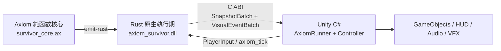

> **Languages / 语言 / 語言**: [English](README.en.md) | [简体中文](README.zh-CN.md) | [繁體中文](README.zh-TW.md)

---

# 🎮 Axiom Survivors：完整 Unity Showcase

`game_survivor` 是一個可執行的 Windows x86_64 Unity 2022 LTS 範例：玩法規則以 Axiom 編寫，轉譯後嵌入 Rust 原生執行期，再通過穩定的 C ABI DLL 將快照與視覺事件傳給 Unity C# 呈現層。

## 為什麼這個範例值得關注

- **100% 純函數玩法核心**：`ax/survivor_core.ax` 的狀態轉移只依賴顯式輸入；時鐘、隨機數、渲染器和 Unity 物件都不會滲入規則層。
- **SMT 形式化契約**：碰撞偵測、HP 限制、減傷、移動和升級規則都宣告了 `requires` / `ensures`，可用 `axiom verify` 靜態檢查並在失敗時回傳反例。
- **核心熱路徑低 GC 壓力**：Rust 執行期預先配置 64 個實體與 16 個視覺事件的固定容量緩衝區，C# 端重複使用雙緩衝快照陣列，避免每個 tick 在資料橋上建立新集合。Unity 預製物件生成、粒子和銷毀仍屬於呈現層的一般配置。
- **真實跨語言邊界**：不是虛擬的 C# 移植。`axiom bridge --target unity` 產生 P/Invoke、結構配置、雙緩衝、資源註冊表與 `MonoBehaviour` Runner，實際呼叫 `axiom_survivor.dll`。

## 架構



| 層 | 職責 | 關鍵檔案 |
| :--- | :--- | :--- |
| Axiom 規則層 | 不可變資料、確定性演算法、前置/後置契約 | [`ax/survivor_core.ax`](ax/survivor_core.ax) |
| Rust 原生層 | 固定容量執行期狀態、排程、穩定 C ABI、DLL 生命週期 | [`native/src/lib.rs`](native/src/lib.rs) |
| 產生橋接層 | P/Invoke 簽名、`Sequential` 結構、C# 雙緩衝、資源對映 | [`Assets/Scripts/AxiomBridge/`](Assets/Scripts/AxiomBridge/) |
| Unity 呈現層 | 輸入、實體視圖生命週期、HUD、動畫、音效與粒子 | [`SurvivorGameController.cs`](Assets/Scripts/Gameplay/SurvivorGameController.cs) |

## 環境需求

- Windows x86_64（建置腳本目前複製 Windows `.dll`）
- Rust stable 工具鏈與 Cargo
- PowerShell 5.1+
- .NET 6 SDK（用於不啟動 Unity 的獨立 C# 驗證）
- Unity `2022.3.62f3` 或相容的 Unity 2022.3 LTS 版本（僅開啟和執行場景時需要）

## 一鍵建置橋接與 DLL

在倉庫根目錄執行：

```powershell
powershell -ExecutionPolicy Bypass -File examples/game_survivor/build_bridge.ps1
```

該腳本會依序：

1. 執行 `axiom bridge --target unity`，重新產生 `Assets/Scripts/AxiomBridge/*.cs`。
2. 執行 `axiom emit-rust`，重新產生 `native/src/generated_core.rs`。
3. 格式化並測試 `axiom-survivor-native`。
4. 建置 release `cdylib`，並將 `target/release/axiom_survivor.dll` 複製至 `Assets/Plugins/x86_64/`。

如需觀察關鍵產生步驟，可手動執行：

```powershell
# 檢查 Axiom 契約
cargo run -p axiom-cli -- verify examples/game_survivor/ax/survivor_core.ax

# 產生 Unity C# 橋接
cargo run -p axiom-cli -- bridge examples/game_survivor/ax/survivor_core.ax `
  --target unity `
  --out examples/game_survivor/Assets/Scripts/AxiomBridge `
  --library-name axiom_survivor

# 產生原生核心使用的 Rust 程式碼
cargo run -p axiom-cli -- emit-rust examples/game_survivor/ax/survivor_core.ax `
  --output examples/game_survivor/native/src/generated_core.rs
```

> `Assets/Scripts/AxiomBridge/*.cs` 與 `native/src/generated_core.rs` 為產生物，請修改 Axiom 原始碼或產生器，不要直接手動編輯這些檔案。

## 不開啟 Unity 執行 E2E 驗證

```powershell
# Rust 工作區與原生執行期
cargo test --workspace

# 重新產生橋接、測試原生執行期、建置並安裝 DLL
powershell -ExecutionPolicy Bypass -File examples/game_survivor/build_bridge.ps1

# 透過 Unity API stubs 執行真實 P/Invoke 與 C# 呈現層測試
dotnet run --project examples/game_survivor/Tests/Standalone/SurvivorRuntimeTests.csproj
```

獨立套件驗證 DLL 初始化、100 次 tick 後的快照修訂號、實體視圖的建立/更新/移除，以及視覺事件路由。

## 在 Unity 中執行

1. 以 Unity Hub 開啟 `examples/game_survivor/`，然後開啟 `Assets/Scenes/SampleScene.unity`。
2. 在同一個 GameObject 上新增 `AxiomRunner` 與 `SurvivorGameController`。Controller 會自動尋找同物件的 Runner。
3. 透過 **Assets > Create > Axiom > Asset Registry** 建立 `AxiomAssetRegistry`，為 `EntityKind` / `VisualEventKind` 設定預製物件與可選音效，並將資產指定給 Runner。
4. 在 Controller 上指定實體根節點，以及可選的 Sprite、Animator、AudioSource、ParticleSystem 與血量/等級/分數 HUD 參照。
5. 進入 Play Mode。預設使用 Legacy Input 的 `Horizontal`、`Vertical` 與 `Fire1`；也可關閉 `pollLegacyInput` 並從自訂輸入系統呼叫 `SetInput`。

## 驗證邊界

- `axiom verify` 證明 Axiom 核心中已宣告的數值契約；它不宣稱形式化證明 Unity 渲染、原生排程或資產設定。
- Rust 測試檢查 100 tick 內固定緩衝區沒有重新配置；獨立 .NET 套件檢查 C ABI、雙緩衝與 Unity 呈現邏輯。
- 實際場景、預製物件、動畫與效能目標仍應於 Unity Editor/Player 中驗收。
