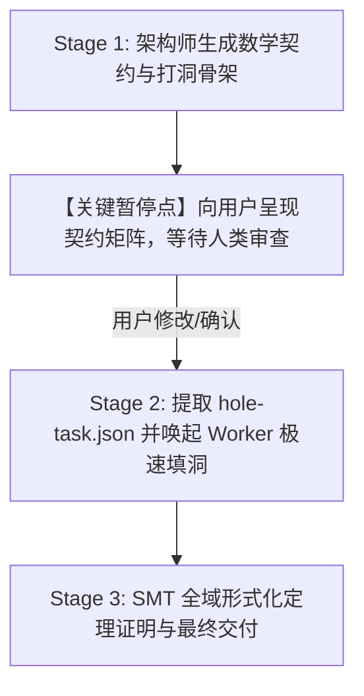

---
name: axiom-interactive
description: Axiom 分阶段人机协作打洞流水线。Stage 1 先生成形式化数学契约骨架与打洞点并暂停等待用户审查确认；Stage 2 用户确认后自动分发 Worker 极速填洞并执行 SMT 全域证明与交付。当用户要求分步审查契约、人机协作开发 Axiom 功能、提到 /axiom-interactive 或需要确认业务数学规则时使用。
---

# Axiom 分阶段人机协作流水线 (Axiom Interactive Pipeline)

本 Skill 用于 **人类开发者主导业务契约、AI 极速负责无错实现** 的分阶段人机协作场景。

---

## 🚦 分阶段人机协作工作流



---

## 📋 详细执行步骤

### 阶段 1：契约生成与人类审查 (Architect & Human Review)
1. **生成骨架**：由架构师编写 ADT 数据模型与带 `requires`/`ensures` 的打洞骨架（函数体均为 `?hole`）；
2. **生成契约审查报告**：向用户展示 Markdown 契约矩阵表格（包含每个函数的入参范围、数学公式与后置保障）；
3. **⛔ 严格暂停**：明确向用户提问，确认契约与边界约束是否符合预期（例如：“是否需要允许负数伤害？”、“Boss 狂暴血线阈值是否设为 33%？”）。

### 阶段 2：填洞实施 (Worker Execution)
1. 用户确认通过后，执行 CLI 提取微型打洞任务：
   ```bash
   cargo run -p axiom-cli -- extract-holes <FILE_HOLES.ax> --out-dir .scratch/holes/
   ```
2. 调度微型 Worker Agent 依据 `axiom-worker` 规范并发填洞，保持 $O(1)$ 超轻量上下文（每个洞 ~150 Tokens）。

### 阶段 3：SMT 形式化闭环 (Verification & Delivery)
1. 组装填补后的 `.ax` 源码并执行全域证明：
   ```bash
   cargo run -p axiom-cli -- verify <FILLED_FILE.ax>
   ```
2. 向用户汇报最终的全域数学证明结果与 Token 消耗报告。
