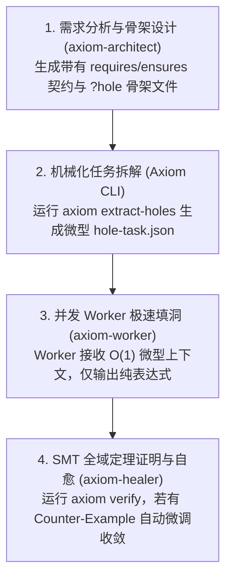

---
name: axiom-pipeline
description: Axiom 全自动打洞流水线。自动串联 Architect 骨架设计 -> extract-holes 任务拆解 -> 并发 Worker 纯表达式填洞 -> SMT 全域定理证明 -> Healer 自愈。当用户要求全自动端到端实现 Axiom 功能、提到 /axiom-pipeline 或一键构建 Axiom 系统时使用。
---

# Axiom 全自动打洞流水线 (Axiom End-to-End Pipeline)

本 Skill 用于以 **最高 Token 效率 (节省 90%+)** 自动化端到端生成并通过 SMT 验证 Axiom 系统。

---

## ⚡ 标准执行流水线 (4 步闭环)



---

## 🛠️ 流水线具体执行步骤

### 阶段 1：架构师骨架设计 (`axiom-architect`)
- 根据用户需求，设计代数数据类型（ADT）与带有严密 `requires`/`ensures` 的函数签名；
- 将每个函数的函数体显式置为 `?hole`；
- 输出 `.ax` 骨架文件，例如 `src/engine_holes.ax`。

### 阶段 2：提取微型 Hole 任务 (`Axiom CLI`)
- 执行提取命令将每个 Hole 拆分为独立的微型上下文（仅 ~100 Tokens）：
  ```bash
  cargo run -p axiom-cli -- extract-holes <FILE_HOLES.ax> --out-dir .scratch/holes/
  ```

### 阶段 3：微型 Worker 极速填洞 (`axiom-worker`)
- 并发调用 Worker Agent 处理每个 `hole-task.json`；
- **Worker 黄金铁律**：只输出目标类型的单一纯表达式（~15 Tokens），绝对不写 `fn` 头部、不引入外部文件探索；
- 自动将 Worker 输出的纯表达式填入 AST / 骨架中。

### 阶段 4：SMT 形式化验证与自愈 (`axiom verify` + `axiom-healer`)
- 运行形式化数学证明：
  ```bash
  cargo run -p axiom-cli -- verify <FILLED_FILE.ax>
  ```
- **自愈闭环**：若出现 `[ContractViolation]`，提取求解器给出的 `Counter-Example`，由 `axiom-healer` 补全分支或收紧 `requires`，再次验证直至 **100% `[VERIFIED]`**。
